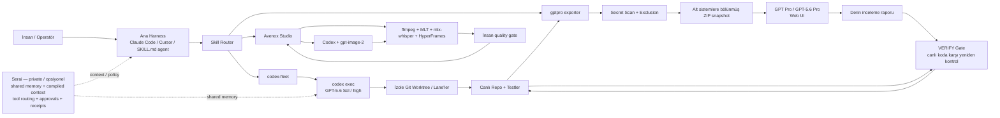
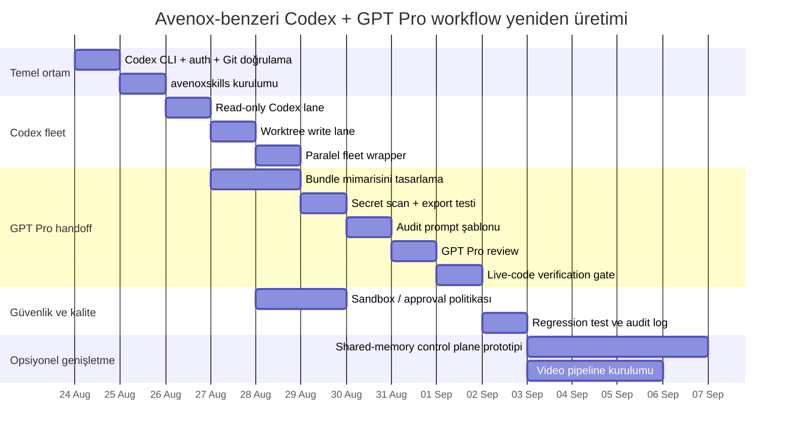

# AvenoxAI Codex + GPT Projesi: Teknik Tersine-Mühendislik ve Yeniden Üretim Raporu

> Durum notu (2026-09-27): v3, bu araştırmanın en güncel tamamlanmış revizyonudur; v1 ve v2 tarihsel sürümler olarak korunur. Zaman-duyarlı model/fiyat iddiaları yalnız içeride belirtilen kaynak erişim tarihleri itibarıyla geçerlidir.

> **Revizyon v3 — 21 Ağustos 2026.** Bu sürüm, v2 üzerindeki ikinci bağımsız review'da bulunan 5 ek uygulanabilirlik/sürüm-doğruluğu bulgusunu da kapatır. Fleet `mktemp` şablonu düzeltildi; Codex CLI `0.147.0` için `--full-auto` durumu kaynak ağacına göre güncellendi; etiketsiz teknik iddialar kaynaklandı veya açıkça yazar alternatifi olarak ayrıldı; boş video kanıt sütunu kaldırıldı; WSL referans ortamı Ubuntu 24.04 LTS + açık Node minimumuyla sabitlendi.

### Review kapanış özeti

| # | Bulgu | v2 çözümü | Durum |
|---|---|---|---|
| 1 | İç araştırma referansları standalone doğrulanamıyor | `[A#]`, `[O#]`, `[Y#]` kaynak sistemi + URL/başlık/erişim tarihi eki | ✅ Kapandı |
| 2 | `curl ... | sh` güvenli kurulum ilkesiyle çelişiyor | Kopyala-çalıştır akışından kaldırıldı; sürüm sabitli npm kurulumu kullanıldı | ✅ Kapandı |
| 3 | Auth adımı yok | `codex login`, `codex login status` ve read-only smoke test eklendi | ✅ Kapandı |
| 4 | Fleet örneği hata kodlarını güvenilir toplamıyor | Bash shebang, PID dizileri, her PID için ayrı `wait`, `mktemp` logları ve final failure exit eklendi | ✅ Kapandı |
| 5 | Worktree örneğinde `--full-auto` approval gate ile çelişiyor | Bayrak kaldırıldı; diff/test/human merge gate eklendi | ✅ Kapandı |
| 6 | `2>/dev/null` kritik hataları gizliyor | Operasyon örneklerinde stderr per-run log'a gidiyor ve exit code kontrol ediliyor | ✅ Kapandı |
| 7 | Skill kurulum blokları tutarsız | Tek, idempotent-olmayan ama fail-fast temiz kurulum akışı verildi; üç skill birlikte kuruluyor | ✅ Kapandı |
| 8 | Görsel input “hatalı” örneği gotcha'yı göstermiyor | Greedy `-i` durumunu gerçekten ayıran örnek + `--` sınırı verildi | ✅ Kapandı |
| 9 | Export cwd/prerequisite/Windows yolu eksik | `gptpro` çalışma dizini, `bundles.conf` konumu, Node/zip/rsync ve WSL2 yolu eklendi | ✅ Kapandı |


### v2 → v3 ikinci review kapanış özeti

| # | Bulgu | v3 çözümü | Durum |
|---|---|---|---|
| 10 | Fleet `mktemp` şablonu `.log` ile bittiği için geçersiz | Şablon `lane-${i}.XXXXXX` olarak düzeltildi; uzantı varsayımından vazgeçildi | ✅ Kapandı |
| 11 | `--full-auto` 0.147.0'da artık `codex exec` seçeneği değil | `deprecated` nitelemesi kaldırıldı; 0.147.0 kaynak ağacında seçeneğin bulunmadığı açıkça yazıldı | ✅ Kapandı |
| 12 | Bazı model/studio/sandbox/Pro iddiaları etiketsiz | Avenox/OpenAI kaynak etiketleri eklendi; API↔ChatGPT Pro eşdeğerliği iddiası kaldırıldı | ✅ Kapandı |
| 13 | Video envanterindeki `Kanıt` sütunu boş | Boş sütun kaldırıldı; doğrudan doğrulanabilen videolar kaynak ekindeki `[Y#]` etiketleriyle satır içinde eşleştirildi | ✅ Kapandı |
| 14 | WSL örneği Node/Ubuntu sürümünü sabitlemiyor | Hedef Ubuntu 24.04 LTS; `@openai/codex` paket minimumu Node `>=16`; referans Node 22 LTS + runtime version gate eklendi | ✅ Kapandı |

**Kanıt sınıfları:** `[A#]` Avenox birincil kaynağı; `[O#]` OpenAI resmî kaynağı; `[Y#]` YouTube/video kaynağı; **Yazar çıkarımı** ise Avenox implementation'ı gibi sunulmaz.

## Yönetici özeti

AvenoxAI kanalında “Codex + GPT” diye tek bir monolitik uygulamadan ziyade, **aynı geliştirme felsefesinin birbirine bağlanan birkaç parçası** görülüyor. İncelediğim birincil kaynaklarda en net şekilde doğrulanabilen yapı şudur: bir ana ajan/harness, yerel **OpenAI Codex CLI** süreçlerini `codex exec` ile paralel “lane”ler halinde çalıştırıyor; çok derin mimari veya kod incelemeleri için kod tabanı `gptpro` aracıyla temizlenip mantıksal ZIP paketlerine ayrılıyor; bu statik snapshot **GPT Pro / GPT‑5.6 Pro** tarafına aktarılıyor; dönen rapor doğrudan uygulanmıyor, canlı kod ağacında tekrar doğrulanıyor. [A1][A2][A3][A4] Daha geniş çapta özel geliştirilmekte olan **Serai** katmanı Codex, Claude Code, Cursor, Hermes ve benzeri ajanlara ortak bellek, derlenmiş context, araç yönlendirme, onay ve işlem kaydı sağlamak üzere tasarlanıyor. [A5][A6]

En önemli teknik bulgu, public çekirdeğin **LangChain tabanlı görünmemesi**. Avenox’un yayımladığı `avenoxskills` kodunda Codex entegrasyonu doğrudan yerel CLI üzerinden yapılıyor; `codex-fleet` kendisini “plain local `codex` install” üzerinde çalışan ve haricî control-plane gerektirmeyen bir skill olarak tanımlıyor. `gptpro` da dosya paketleme + web UI handoff modeli kullanıyor. İncelediğim Avenox birincil kaynaklarında LangChain, LangGraph veya OpenAI Agents SDK çekirdek bağımlılık olarak gösterilmiyor; bu **“kesinlikle hiçbir private bileşende yok”** anlamına gelmez. [A1][A2][A3]

Avenox’un halka açık `codex-fleet` skill’i varsayılan olarak **`gpt-5.6-sol` + `high` reasoning** kullanıyor ve kendi prerequisite metninde Codex CLI için **0.128+** yazıyor. [A2] OpenAI’nin 21 Ağustos 2026’da erişilen model belgesi `gpt-5.6-sol` için **1.050.000 context window** ve **128.000 maksimum output** veriyor. [O4] Buna karşılık OpenAI’nin GPT‑5.6 yardım sayfası aynı tarih itibarıyla GPT‑5.6 için **Codex CLI 0.144.0 minimumu** veriyor; dolayısıyla yeni kurulumda Avenox repo’sundaki eski `0.128+` minimumuna değil güncel resmî minimuma uyulmalıdır. [O5] Bu rehberin copy-paste akışı ise ikinci review sırasında doğrulanan **0.147.0** sürümünü reproducibility referansı olarak pinler; bu pin “minimum budur” anlamına gelmez. [O11]

“GPT‑5.6 Pro” konusunda önemli bir nüans var. Avenox’un videosu bu adı kullanırken `gptpro-handoff` dokümanı genel olarak “GPT Pro on the ChatGPT web UI” diyor. [A4][Y1] OpenAI’nin ürün belgelerinde ChatGPT tarafında “GPT‑5.6 Sol Pro” deneyimi bulunabilir; fakat videodaki web-UI çalışmasının **tam backend snapshot/model kimliği halka açık Avenox kaynaklarında belirtilmemiştir**. Bu nedenle yalnız video başlığından API’de ayrı bir `gpt-5.6-pro` slug’ı varmış sonucu çıkarılmamalıdır. [O5]

Avenox yaklaşımının asıl ayırt edici noktası model seçiminden çok **context engineering + verification loop** tarafında. `gptpro-handoff` sıkı audit görevlerinde `VERIFIED` / `HYPOTHESIS` ayrımı, invariant’lar ve belirli çıktı yapısı öneriyor; rapor geldikten sonra canlı kod tabanında yeniden doğrulama zorunlu kapı olarak tanımlanıyor. [A4]

Tam Serai sistemini birebir yeniden üretmek bugün mümkün değil: [A5][A6] Avenox’un GitHub profili Serai’yi **private, active development** olarak tanımlıyor; `serai.run` da private beta kapısı gösteriyor. Buna karşılık Codex fleet, GPT Pro handoff ve video pipeline’ın önemli bölümleri yayımlanmış durumda ve bunlar kullanılarak kamuya açık mimarinin büyük kısmı yeniden kurulabilir.

## Video envanteri, zaman damgaları ve kanıt düzeyi

YouTube doğrudan video sayfalarının bir kısmını araştırma sırasında throttle ettiği için, aşağıdaki liste **YouTube arama indeksinden ve Avenox’un bağlı GitHub kaynaklarından doğrulayabildiğim tüm proje-odaklı videoları** kapsıyor. Yalnızca ekranda görünen fakat açıklama/index/repo tarafında bulunmayan kodu güvenilir biçimde okuyamadığım yerlerde bunu “belirtilmemiş” olarak işaretledim; herhangi bir timestamp veya kod satırı tahmin edilmedi. YouTube’un throttle davranışı özellikle bazı video sayfalarının doğrudan transcript/frame erişimini engelledi.

| Video | Projedeki rolü | Doğrulanabilen önemli bölümler | Kod/bağlantı izi |
|---|---|---|---|
| **Context Kazandı Demiştim — İşte Context'i Üreten Model: GPT 5.6 Pro** — `xmMwgggOAmw`, 8 Ağustos 2026 [Y1] | GPT Pro’nun büyük codebase snapshot’ından context/inceleme üretmesi; Codex↔GPT Pro handoff’ın en doğrudan videosu | `00:00` giriş; `00:22` hedef kullanıcı/bağlam; `07:54` **“Skill'ler ve codebase export”**; `08:48` **“Codebase'i …”** — indeks burada açıklamayı kesiyor | `gptpro`, `gptpro-handoff` repo uygulamasıyla doğrudan örtüşüyor |
| **Context'i Yanlış Kullanıyorsunuz — Ben Böyle Yapıyorum \| Claude Code - Codex** — `4vWlWHDol-g`, yaklaşık 15 Ağustos 2026 [Y2] | Context engineering ve model-routing yaklaşımı | `0:00` context paniğine gerek olmadığı giriş; `0:28` model merdiveni/routing tartışması | Açıklama indeksinde `codex-fleet → github.com/avenoxai` bağlantısı görülüyor |
| **Videolarımı Yapan Yapay Zeka Sistemini Paylaşıyorum** — `6jRuCfCiOLA`, yaklaşık 19 Ağustos 2026 [Y3] | Avenox Studio: Codex/agent skill’leriyle video üretim sistemi | YouTube indeksinde güvenilir chapter listesi çıkmadı: **timestamp belirtilmemiş** | Public `avenoxskills` içinde `avenox-video`, `roughcut`, `graphics`, `thumbnail`; thumbnail tarafında paralel `gpt-image-2` işleri [A1] |
| **Fable 5 ile Kanalımın En Değerli Videosunu Çektim — Skill'imi Paylaşıyorum** — `2n84xa99FRY`, Temmuz 2026 [Y4] | Skill paylaşımı, codebase/context paketleme yaklaşımının öncülü/uygulaması | `0:00` giriş; `0:51` Codex/Cloud skill paylaşımı; `1:04` kaynakların ücretsiz olduğu bölüm; `1:57` codebase mimarisi | Açıklama indeksinde `avenox.lol/codex.md` [A7] |
| **Sıkıcı Kodlama Yayını: Codex + Claude Code ile Çalışıyorum** [Y7a][Y7b] | Gerçek çalışma oturumu; Codex + Claude Code + Serai altyapısı | İndekslenen varyantta `0:00` açılış/radyo; `07:12` Herder repo incelemesi; `09:04` model değiştirme felsefesi; `11:34` Codex bölümü | Açıklama `avenox.lol/radio/` [A9]; iki video ID'sinin aynı upload olup olmadığı belirsiz |
| **AI'a (Claude) Oyun Fabrikası Kurmak — Bölüm 2** — `TREm_35AtB4` [Y5] | GPT Pro’dan gelen bulguları Codex’e doğrulatma örneği | İndeks açıklamasında açıkça **“Codex'e doğrulatmak”** ve **“GPT Pro / Codex”**; `29:23` kapanış ve worktree tavsiyesi. GPT Pro/Codex bölümünün başlangıç zamanı indeks kesintisi nedeniyle **belirtilmemiş** | Worktree + doğrulama yaklaşımı [A4] |
| **20 AI Agent'ı Tek Hafızada Çalıştırdım \| Hermes - Claude - Codex** | Serai/shared-memory katmanının en doğrudan video göstergelerinden biri | Arama sonuçlarında başlık doğrulanıyor; güvenilir chapter/timestamp ve doğrudan video ID indekslenemedi: **belirtilmemiş** | GitHub profilindeki Serai açıklaması aynı agent seti/shared-memory tasarımıyla örtüşüyor [A5][A6] |
| **Context Toplamaya Saatler Harcıyorum, İşte Nedeni (Claude - Codex)** | Context’in elle/ajanlarla derlenmesi ve iki coding-agent arasında taşınması | Başlık Avenox’un video önerilerinde doğrulanıyor; ID/chapter **belirtilmemiş** | Serai’nin “compiled context” amacıyla kavramsal olarak örtüşüyor [A5]; bunun aynı implementation olduğunu video kaynağı doğrulamıyor |
| **Seni Hatırlayan Yapay Zekâ: Tek Komutla Kendi İkinci Beynini Kur** — `a-vO-Re4UqY`, 30 Haziran 2026 [Y6] | Paylaşımlı/persisted memory düşüncesinin erken halka açık örneği | Güvenilir chapter dökümü alınamadı: **belirtilmemiş** | Açıklama indeksinde `avenox.lol/beyin.md` [A8] |
| **Prompt Öldü, Context Kazandı — Modelin Gözünden Kanıtı** | Projenin prompt/context felsefesini anlatan destekleyici içerik | Arama sonuçlarında yaklaşık 21 dakikalık Avenox videosu olarak görünmekle birlikte doğrudan ID/chapter güvenilir biçimde çıkmadı | Kod implementasyonu için `gptpro-handoff` birincil kaynakları daha güçlü kanıt [A4] |

Buradaki “Sıkıcı Kodlama Yayını” için YouTube indeksinde **iki farklı video kimliği** (`Bgvie9LtQdk` ve `3inA7z3uk2I`) aynı veya çok benzer başlıklarla yüzeye çıktı. Bir indeks kaydı Serai/Codex/Claude çalışma açıklamasını, diğeri chapter listesini taşıyor. Bunların yeniden yükleme, ikinci yayın veya indeks eşleştirme hatası olup olmadığı halka açık metinden kesinleştirilemedi; bu nedenle iki ID’yi tek kayıt gibi kesin biçimde birleştirmek doğru olmaz.

Ayrıca kanalın **“GPT‑5.6 SOL ULTRA: Saatlerce Sapmadan Çalışan Model”**, **“GPT‑5.6 Sol vs. Claude Fable 5”**, **“GPT‑5.6 SOL'un Bu Yaptığı…”** ve çoklu model benchmark videoları GPT‑5.6 Sol’un kapasitesini gösteriyor, fakat bunlar Codex→GPT Pro→verification mimarisini doğrudan anlatmadığından ana proje envanterinden ayrı tutulmalıdır. Avenox GitHub profili de model benchmark çıktılarını “model tests” kategorisinde, agent infrastructure’dan ayrı sınıflandırıyor.

**Video açıklamalarından / proje kaynaklarından doğrulanabilen bağlantılar:**

```text
https://avenox.lol/codex.md
https://avenox.lol/beyin.md
https://avenox.lol/radio/
https://github.com/avenoxai
https://github.com/avenoxai/avenoxskills
https://serai.run/
```

İlk üçü ilgili YouTube indeks açıklamalarında yüzeye çıktı; `avenoxskills` ve Serai adresleri Avenox’un resmî GitHub profil/repo kaynaklarıyla doğrulanıyor.

## Kod, CLI, konfigürasyon ve prompt dökümü

Önemli bir kaynak sınırlaması var: YouTube video dosyalarının karelerini güvenilir biçimde indiremediğim için **yalnızca videonun ekranında görünen ve başka hiçbir yerde yayımlanmamış kod parçalarını birebir transkribe etmek mümkün olmadı**. YouTube sayfaları araştırma sırasında fetch-throttling uyguladı. Bu yüzden aşağıdaki “birebir” bloklar videolarla bağlantılı **Avenox’un yayımladığı çalışan repo kodundan** alınmıştır; yalnız ekran görüntüsünde kalmış parçalar ise “belirtilmemiş” kabul edilmiştir. Avenox’un kendi GitHub profili YouTube’da cilalanmış açıklamaların, GitHub’da ise raw prompt’ların, model output’larının, failure’ların ve çalışan kodun tutulduğunu söylüyor.

**Avenox kaynağındaki davranış — kanıt, kopyala-çalıştır rehberi değil:**

Avenox `codex-fleet` kaynağı plain local Codex kurulumunu, `gpt-5.6-sol`, `high` reasoning, varsayılan `read-only` sandbox ve kendi örneklerinde `--skip-git-repo-check` kullanımını belgeliyor. Aynı kaynak bazı komutlarda stderr'i `2>/dev/null` ile bastırıyor. [A2] Bu raporda bu desenler **Avenox'un public implementation kanıtı** olarak kayda geçirilir; fakat operasyon rehberinde aynen önerilmez. Çünkü OpenAI `codex exec` ilerleme/hata bilgisini stderr'e yazar ve Git repo kontrolünün yalnız güvenli olduğu bilinen ortamlarda atlanmasını önerir. [O2]

Aynı konuşmayı sürdürme (`resume`) davranışı da public skill'de mevcut; ancak v2'de auth, sandbox veya rate-limit hatalarının kaybolmaması için stderr susturulmaz. [A2][O2]

Görsel input için repo özellikle `-i/--image` parsing gotcha'sını belgeliyor. Risk, image argümanı listesinin prompt metnini de tüketebilmesidir; bu yüzden prompttan önce açık `--` sınırı kullanmak güvenlidir. [A2]

```bash
# Riskli: ref2.png'den sonraki tokenlar image listesine karışabilir.
codex exec [opts] -i ref1.png ref2.png "prompt text"

# Güvenli sınır: bundan sonrası positional prompt.
codex exec [opts] -i ref1.png ref2.png -- "prompt text"
```

Image-generation tarafında `codex-fleet`, **`gpt-image-2`** ile image-generation görevleri çalıştırıyor; Avenox repo’su bu entegrasyonu açıkça listeliyor. [A1] OpenAI’nin güncel GPT Image 2 model sayfası hem `gpt-image-2` alias’ını hem de `gpt-image-2-2026-04-21` snapshot’ını listeliyor ve modeli image generation/editing için güncel state-of-the-art seçenek olarak tanımlıyor. [O10] API anahtarı gerektiren doğrudan API fallback davranışı kullanılıyorsa `OPENAI_API_KEY` gerekir; bu cümle Avenox skill’inin ilgili fallback akışına ilişkindir. [A2]

**GPT Pro için codebase export — kaynak davranışının çalışma dizini açık biçimde yazılmış hali:**

Avenox `gptpro` kaynağında exporter `scripts/export.sh`, config ise aynı skill kökündeki `bundles.conf`/`bundles.example.conf` üzerinden tanımlanır; gereksinimler arasında `zip` ve `rsync` vardır. [A1][A3]

```bash
GPTPRO_DIR="/path/to/avenoxskills/skills/gptpro"
cd "$GPTPRO_DIR"

# Config bu dizinde bulunur.
[[ -f bundles.conf ]] || cp bundles.example.conf bundles.conf

PROJECT_ROOT=/path/to/repo \
OUTPUT_DIR="$HOME/Desktop/review-bundles" \
BUNDLE_PREFIX=myproject \
./scripts/export.sh
```

Konfigürasyonun temel biçimi:

```bash
define_bundle core \
  "domain logic — the most important bundle for architecture review" \
  dir:packages/core

define_bundle db \
  "schema architecture only — no rows, no seed data" \
  dir:supabase/migrations \
  file:supabase/config.toml:supabase \
  file:docs/DB_PLAN.md

define_bundle docs \
  "architecture and convention context" \
  dir:docs dir:adrs file:README.md file:AGENTS.md
```

Exporter workspace paketlerini, servisleri ve dokümanları mantıksal alt sistemlere ayırır; `node_modules`, build çıktıları, binary asset’ler ve secrets gibi taşınmaması gereken materyalleri dışarıda bırakır. Avenox repo’sunda secret taraması hard credential pattern'lerinde **hard abort** olacak biçimde tasarlanmıştır. [A3]

**Video sistemi environment ayarları — kaynakta birebir:**

```bash
export STUDIO_JOBS="$HOME/video/projects"
export STUDIO_ROOT="/path/to/this/repo"
```

Avenox Studio yerel-first çalışıyor; Avenox README’si video skill’leri için macOS’ta hardware encode ve Apple Silicon’da `mlx-whisper`, ayrıca `ffmpeg`, Python 3, MLT/`melt` ve Node gereksinimlerini listeliyor; Linux’ta `libx264` ve CUDA tabanlı Whisper ikamelerini not ediyor. [A1] Kullanılan exact `ffmpeg`, Node, MLT ve Python sürümleri public belgede **belirtilmemiştir**.

**Prompt engineering biçimi**, projenin en ayırt edici parçalarından biri. Kaynakta verilen İngilizce şablonu kelimesi kelimesine çoğaltmak yerine, aynı yapının teknik olarak eşdeğer Türkçe özeti şöyledir:

```xml
<ROLE>
Bu kod tabanını generic tavsiyelerle değil, gerçek implementasyondan
hareketle değerlendirecek belirli bir kıdemli uzman rolü.
</ROLE>

<TASK>
Verilecek karar veya deliverable.
Birden fazla hedef varsa açıkça numaralanmış hedefler.
</TASK>

<CONTEXT>
Gerçek mimari.
Önce okunacak authoritative dosyalar.
İlgili file anchor'ları.
Ölçümler / empirical signals.
Doğrulanması veya çürütülmesi gereken hipotezler.
Değiştirilemez invariant'lar.
</CONTEXT>

<UNCERTAINTY>
Her bulguyu VERIFIED veya HYPOTHESIS olarak ayır.
Kaynakta olmayan line number/API/ölçüm üretme.
Varsayımları açıkça belirt.
</UNCERTAINTY>

<OUTPUT>
Kısa yönetici özeti.
Kanıta dayalı bulgular.
Önceliklendirilmiş roadmap.
Invariant'ı ihlal eden öneriler için DO-NOT kayıtları.
Sınırlı sayıda açık soru.
</OUTPUT>

<CONSTRAINTS>
Ekli kod ve dokümanlara dayan.
Docs/code drift'i ayrıca işaretle.
Gerekmedikçe sıfırdan rewrite önermeme.
Governance/consistency invariant'larını zayıflatmama.
</CONSTRAINTS>
```

Avenox’un “prompt house style”ı ayrıca **audit için tight leash, research için loose leash** öneriyor. Audit’te `VERIFIED/HYPOTHESIS`, sabit çıktı ve confirm/refute zorlanırken; araştırmada modelin verilen hipotezlerin ötesine geçmesine, framing’i sorgulamasına ve yeni teori üretmesine açık izin veriliyor. Her iki durumda da invariant’lar sert tutuluyor.

Bu yapı klasik anlamda bir **fine-tuning** değildir. Halka açık kaynaklarda model ağırlıklarının eğitildiğine, LoRA/adaptor kullanıldığına veya OpenAI fine-tuning endpoint’inin kullanıldığına dair kanıt yok. “Bir iyi promptu house reference olarak sakla ve yeni prompt yazmadan önce oku” tavsiyesi ise pratikte bir **in-context exemplar/few-shot-benzeri çalışma biçimi** oluşturuyor, ancak bunun API düzeyinde formal few-shot dataset mekanizması olduğu söylenmiyor.

## Modeller, bağımlılıklar ve yeniden kurulan sistem mimarisi

Aşağıdaki tablo “videoda/repo’da gerçekten kullanılan”, “resmî olarak doğrulanabilen” ve “belirtilmemiş” alanlarını ayırıyor.

| Bileşen | Avenox’ta doğrulanan kullanım | Sürüm/model | Teknik durum |
|---|---|---|---|
| **OpenAI Codex CLI** | Ana coding-agent execution katmanı; `codex exec`, paralel lane, worktree | Avenox metni **0.128+** [A2]; güncel GPT‑5.6 minimumu **0.144.0** [O5] | OpenAI CLI non-interactive `exec`, sandbox ve automation destekliyor. [O2] |
| **GPT‑5.6 Sol** | `codex-fleet` varsayılan coding modeli [A2] | `gpt-5.6-sol`, reasoning=`high` | API model belgesi 1.05M context/128K output listeliyor. [O4] |
| **GPT‑5.6 Pro / GPT Pro** | Slow/deep codebase review [A4][Y1] | Videoda “GPT 5.6 Pro”; skill’de “GPT Pro on ChatGPT web UI” | Exact backend snapshot ve ChatGPT-Pro ↔ API parametre eşlemesi **belirtilmemiş**; bu rapor ChatGPT Pro deneyimini belirli bir API parametresiyle eşdeğer saymaz. [O5] |
| **GPT Image 2** | Görsel/thumbnail üretimi [A1] | `gpt-image-2`; OpenAI ayrıca `gpt-image-2-2026-04-21` snapshot’ını listeliyor [O10] | OpenAI resmî image-generation modeli. [O10] |
| **Claude Code / Cursor** | Ana harness veya Codex’i çağırabilecek parent agent seçenekleri [A1][A2] | Exact Claude modeli akışa göre değişiyor; repo tek bir sürüme pinlemiyor | `codex-fleet` `SKILL.md`-uyumlu harness’larla kullanılabiliyor. [A1] |
| **Serai** | Shared context/control-plane [A5][A6] | Private beta; implementation version **belirtilmemiş** | Scoped memory, compiled context, governed tool routing, approvals, receipts, workflows, version history amaçlanıyor. [A5] |
| **LangChain / LangGraph** | İncelenen public Avenox çekirdeğinde bağımlılık olarak gösterilmiyor [A1][A2][A3] | **Kullanım belirtilmemiş / kanıt yok** | Alternatif implementation olarak uygun olabilir; private Serai bileşenleri hakkında sonuç çıkarmaz. |
| **zip / rsync** | GPT Pro bundle üretim araçları [A3] | Sürümler **belirtilmemiş** | `gptpro` requirements. [A1][A3] |
| **mlx-whisper** | Avenox Studio transkripsiyon [A1] | Model: `whisper-large-v3-turbo`; paket sürümü **belirtilmemiş** | Apple Silicon yerel transcription. [A1] |
| **ffmpeg** | Video encoding/compositing [A1] | **Belirtilmemiş** | macOS hardware encode; Linux alternatifi `libx264`. [A1] |
| **MLT / melt** | Timeline/render pipeline [A1] | **Belirtilmemiş** | Video skill requirements içinde listeleniyor. [A1] |
| **Node + HyperFrames** | Motion graphics [A1] | Sürümler **belirtilmemiş** | Video graphics branch ve Node gereksinimi public repo’da açıklanıyor. [A1] |
| **Docker/Kubernetes** | Public Avenox workflow’da kanıtlanmadı | **Belirtilmemiş** | Serai private olduğu için production container topology bilinmiyor.  |
| **CI/CD** | Avenox’un yayımlanmış Codex+GPT handoff’ında belirtilmemiş | **Belirtilmemiş** | Codex genel olarak CI’da çalıştırılabilir, fakat bu Avenox’un bunu kullandığını kanıtlamaz.  |

API model dokümanındaki context kapasitesi ile belirli bir Codex CLI sürümünün/harness’ın fiilen kullanılabilir context davranışını aynı şey saymamak gerekir. Bu rapor yalnız OpenAI model sayfasındaki API context değerini **model özelliği** olarak verir; CLI/harness tarafında güncel sürüm ve runtime davranışı ayrıca doğrulanmalıdır. [O4][O5]

Yeniden kurulmuş veri akışı aşağıdaki gibi:



Bu diyagramdaki Serai bağlantısı **kavramsal rekonstrüksiyondur**, public backend code’u değildir. Avenox’un public tanımı Serai’nin modelin “dışında” durup memory/context/tool-routing/approval/receipts sağladığını söylüyor; buna karşılık `codex-fleet` Serai’ye ihtiyaç duymadan yerel Codex ile tek başına çalışabiliyor.

Mimarinin kritik veri akışı iki farklı “zeka modu” kullanıyor. **Agentic lane** olan Codex canlı dosya sistemini okuyup komut/test çalıştırabiliyor. **Deep static reviewer** olan GPT Pro ise Avenox’un workflow tanımına göre shell, live repo ve tool erişimine sahip değil; yalnız yüklenen snapshot’ı görüyor. Bu nedenle GPT Pro “propose/reason”, canlı Codex/harness ise “verify/implement” rolüne konmuş.

Güvenlik/guardrail katmanları da mimarinin içine yerleştirilmiş. Codex tarafında Avenox varsayılanı `read-only`; write lane’leri worktree ile izole ediliyor ve yüksek etkili izin yükseltmeleri açık operatör kararı gerektiren risk olarak ele alınıyor. [A2] OpenAI resmî belgeleri sandbox ile approval/policy katmanlarını ayrı kontroller olarak tanımlıyor ve mümkün olan en dar erişimin kullanılmasını öneriyor. [O3] GPT Pro tarafında secret scan hard credential pattern’lerinde exportu abort edebiliyor [A3]; dönen bulgular canlı kodda yeniden doğrulanıyor. [A4] Video pipeline’ın public README’si de agent-operated local-first akış ve thumbnail tarafında hard safety rules bulunduğunu belirtiyor. [A1]

Serai, bu prensibi bir üst katmana taşıyor: shared memory, context compilation, governed tool routing, human approvals ve action receipts. Ancak database türü, embedding modeli, vector store, API framework, authentication sistemi, queue altyapısı, Docker image’ları, Kubernetes kullanımı, CI/CD düzeni veya production hosting sağlayıcısı public kaynaklarda **belirtilmemiştir**.

## Adım adım yeniden üretim ve örnek kod

En yüksek güvenle yeniden üretilebilecek kısım **Serai'nin private backend'i değil, Codex fleet + GPT Pro handoff** workflow'udur. Avenox public repo'su `codex-fleet` için authenticated Codex kurulumu; `gptpro` için `zip` ve `rsync`; video skill'leri için ayrıca Node/Python/ffmpeg gibi araçlar istiyor. [A1][A2][A3]

### 1) Ortam ve ön koşullar

Bu rehberin tam yolu **Bash/POSIX** kabul eder. Gerekli minimumlar:

- Git
- Node.js **>=16** + npm (`@openai/codex` paket minimumu); bu rehberin reproducibility referansı Node 22 LTS'dir [O12]
- `zip` ve `rsync` (`gptpro` exporter için) [A1][A3]
- Bash
- ChatGPT/Codex hesabı veya uygun API kimlik doğrulaması [O1][O2]

Avenox skill metni `Codex CLI 0.128+` dese de, OpenAI'nin 21 Ağustos 2026'da erişilen GPT‑5.6 yardım sayfası **GPT‑5.6 için minimum Codex CLI 0.144.0** veriyor. Yeni kurulumda daha yüksek olan resmî minimum esas alınmalıdır. [A2][O5]

**Reproducible kurulum örneği:**

```bash
# Node/npm kurulu olmalı.
# Bu rapor uzak script'i doğrudan shell'e pipe etmeyi bilerek önermiyor.
npm install -g @openai/codex@0.147.0

codex --version
```

OpenAI'nin resmî README'sinde standalone installer da mevcut olabilir; ancak supply-chain yüzeyini küçültmek ve bu rehberde neyin çalıştırıldığını sabitlemek için kopyala-çalıştır yolunda npm paketi sürüme pinlenmiştir. Kurumsal ortamda paket bütünlüğü/registry politikası ayrıca uygulanmalıdır. [O1]

### 2) Kimlik doğrulama ve read-only smoke test

Temiz makinede ilk agent çağrısından önce login yapın:

```bash
codex login
codex login status
```

OpenAI ayrıca interaktif `codex` çalıştırıp **Sign in with ChatGPT** seçeneğinin kullanılabildiğini; otomasyonlarda scoped API key kullanılabileceğini belgeliyor. Auth materyalini secret kabul edin. [O1][O2]

Ardından gerçek projeye dokunmadan küçük bir **Git repo + read-only** smoke test çalıştırın. Stderr ayrı log'a gider; başarısızlık kodu gizlenmez:

```bash
#!/usr/bin/env bash
set -euo pipefail

SMOKE_DIR="$(mktemp -d "${TMPDIR:-/tmp}/codex-smoke.XXXXXX")"
RUN_DIR="$(mktemp -d "${TMPDIR:-/tmp}/codex-smoke-logs.XXXXXX")"

git -C "$SMOKE_DIR" init -q
printf '# Codex smoke test\n' > "$SMOKE_DIR/README.md"

echo "stdout: $RUN_DIR/stdout.log"
echo "stderr: $RUN_DIR/stderr.log"

if (
  cd "$SMOKE_DIR"
  codex exec \
    -m gpt-5.6-sol \
    -c model_reasoning_effort=high \
    --sandbox read-only \
    "README.md dosyasını oku ve tek cümleyle özetle. Dosya değiştirme." \
    >"$RUN_DIR/stdout.log" \
    2>"$RUN_DIR/stderr.log"
); then
  cat "$RUN_DIR/stdout.log"
else
  rc=$?
  echo "Codex smoke test başarısız (exit=$rc)." >&2
  cat "$RUN_DIR/stderr.log" >&2
  exit "$rc"
fi
```

`codex exec` resmî olarak non-interactive kullanım içindir; varsayılan güvenli profil read-only'dir. Bu rehberin doğruladığı Codex CLI `0.147.0` kaynak ağacında `codex exec` için `--full-auto` seçeneği artık bulunmuyor; dolayısıyla yeni otomasyonlar açık `--sandbox`/permission ayarlarıyla yazılmalıdır. [O2][O11]

### 3) Avenox skill'lerini tek ve tutarlı akışla kurma

Aşağıdaki blok **üç çekirdek skill'i** birlikte kurar ve var olan hedefi sessizce ezmez:

```bash
#!/usr/bin/env bash
set -euo pipefail

SRC="$PWD/avenoxskills"
DEST="$HOME/.claude/skills"

git clone --depth 1 https://github.com/avenoxai/avenoxskills.git "$SRC"
mkdir -p "$DEST"

# Hangi kaynak snapshot'ının kullanıldığını kaydet.
git -C "$SRC" rev-parse HEAD

for skill in codex-fleet gptpro gptpro-handoff; do
  if [[ -e "$DEST/$skill" ]]; then
    echo "Hedef zaten var: $DEST/$skill — önce elle incele/kaldır." >&2
    exit 1
  fi
  cp -R "$SRC/skills/$skill" "$DEST/"
done
```

Avenox README'si skill'lerin Claude Code, Cursor ve `SKILL.md` okuyabilen başka harness'larla da kullanılabildiğini söylüyor. Kurulumdan önce özellikle `SKILL.md` ve çalıştıracağınız shell script'lerini incelemek daha güvenlidir. [A1]

### 4) Gerçek repo için ilk read-only lane

Gerçek repo zaten Git ise `--skip-git-repo-check` kullanmayın:

```bash
#!/usr/bin/env bash
set -euo pipefail

cd /path/to/your/repo
RUN_DIR="$(mktemp -d "${TMPDIR:-/tmp}/codex-readonly.XXXXXX")"

if codex exec \
  -m gpt-5.6-sol \
  -c model_reasoning_effort=high \
  --sandbox read-only \
  "Bu repoyu incele. Mimari riskleri bul. Dosya değiştirme. Her bulgu için ilgili dosyayı ve doğrulama yöntemini belirt." \
  >"$RUN_DIR/stdout.log" \
  2>"$RUN_DIR/stderr.log"
then
  cat "$RUN_DIR/stdout.log"
else
  rc=$?
  echo "Lane başarısız (exit=$rc); stderr: $RUN_DIR/stderr.log" >&2
  cat "$RUN_DIR/stderr.log" >&2
  exit "$rc"
fi
```

Avenox'un exact default'unda `--skip-git-repo-check` görülür; OpenAI ise bu kontrolün yalnız ortamın güvenli olduğundan eminseniz bypass edilmesini önerir. Bu v2 akışı bilinçli olarak daha muhafazakârdır. [A2][O2]

### 5) Yazma lane'i: izole worktree + merge öncesi insan kapısı

Concurrent edit yapan ajanları ayrı Git worktree'lere ayırmak Avenox yaklaşımının önemli parçasıdır. [A2] Aşağıdaki örnek `--full-auto` kullanmaz; Codex değişiklikleri yalnız izole worktree'de yapar, sonra operatör diff/test sonucunu inceleyip merge kararı verir:

```bash
#!/usr/bin/env bash
set -euo pipefail

ROOT="$(git rev-parse --show-toplevel)"
BRANCH="agent/refactor-auth"
WORKTREE="$ROOT/../worktrees/refactor-auth"
RUN_DIR="$(mktemp -d "${TMPDIR:-/tmp}/codex-write.XXXXXX")"

mkdir -p "$(dirname "$WORKTREE")"
git worktree add -b "$BRANCH" "$WORKTREE" HEAD

if (
  cd "$WORKTREE"
  codex exec \
    -m gpt-5.6-sol \
    -c model_reasoning_effort=high \
    --sandbox workspace-write \
    "Auth modülünü yalnız bu worktree içinde refactor et. Mevcut testleri koru; yeni davranış için regression test ekle. Sonunda yaptığın değişiklikleri ve önerdiğin test komutunu raporla." \
    >"$RUN_DIR/stdout.log" \
    2>"$RUN_DIR/stderr.log"
); then
  cat "$RUN_DIR/stdout.log"
else
  rc=$?
  echo "Write lane başarısız (exit=$rc). Worktree korunuyor: $WORKTREE" >&2
  cat "$RUN_DIR/stderr.log" >&2
  exit "$rc"
fi

# Agent'ın çıktısından bağımsız yerel kontroller.
git -C "$WORKTREE" status --short
git -C "$WORKTREE" diff --check

# Projenizin gerçek test komutunu operatör çalıştırmalı, örn.:
# (cd "$WORKTREE" && npm test)

printf '\nHUMAN GATE: diff + test sonucu onaylanmadan merge etmeyin.\n'
# İnceleme sonrası istenirse:
# git worktree remove "$WORKTREE"
```

Codex CLI `0.147.0` için resmî tag’deki `codex exec` CLI tanımında `--full-auto` seçeneği yoktur; bu sürümde bayrak kabul edilmemelidir. Bu nedenle örnek yalnız açık `--sandbox workspace-write` kullanır. [O11]

### 6) Paralel read-only fleet: PID ve exit-code güvenli örnek

Bağımsız investigation lane'leri paralel çalıştırmak Avenox `codex-fleet`'in temel davranışıdır. [A2] Aşağıdaki wrapper Bash array kullandığı için shebang içerir; log isimleri `mktemp` ile benzersizdir; her PID ayrı beklenir ve tek lane'in hatası tüm fleet sonucuna yansır:

```bash
#!/usr/bin/env bash
set -uo pipefail

prompts=(
  "Auth akışındaki race condition risklerini araştır. Değişiklik yapma."
  "Database migration dosyalarını backward compatibility açısından incele. Değişiklik yapma."
  "API error handling ve retry davranışını incele. Değişiklik yapma."
)

RUN_DIR="$(mktemp -d "${TMPDIR:-/tmp}/codex-fleet.XXXXXX")"
pids=()
logs=()

for i in "${!prompts[@]}"; do
  log="$(mktemp "$RUN_DIR/lane-${i}.XXXXXX")"
  logs+=("$log")

  codex exec \
    -m gpt-5.6-sol \
    -c model_reasoning_effort=high \
    --sandbox read-only \
    "${prompts[$i]}" \
    >"$log" 2>&1 &

  pids+=("$!")
done

failed=0
for i in "${!pids[@]}"; do
  if wait "${pids[$i]}"; then
    echo "lane[$i] OK — ${logs[$i]}"
  else
    rc=$?
    failed=1
    echo "lane[$i] FAIL exit=$rc — ${logs[$i]}" >&2
    tail -n 80 "${logs[$i]}" >&2 || true
  fi
done

if (( failed != 0 )); then
  echo "Fleet en az bir başarısız lane içeriyor." >&2
  exit 1
fi
```

Bu wrapper **Avenox'un exact scheduler kodu değildir**; public “independent work → parallel lanes” prensibini güvenli bir Bash örneğine çevirir.

### 7) GPT Pro snapshot/export: doğru çalışma dizini ve config konumu

`gptpro` için `zip` ve `rsync` gereklidir. [A1][A3] `bundles.conf`, `gptpro` skill dizinindeki `bundles.example.conf` dosyasından oluşturulur; exporter da o dizindeki `scripts/export.sh` üzerinden çağrılır:

```bash
#!/usr/bin/env bash
set -euo pipefail

GPTPRO_DIR="/path/to/avenoxskills/skills/gptpro"
PROJECT_ROOT="/path/to/your/repo"
OUTPUT_DIR="$HOME/Desktop/review-bundles"

cd "$GPTPRO_DIR"

# İlk kurulumda bir kez oluştur; sonra içeriklerini projene göre düzenle.
[[ -f bundles.conf ]] || cp bundles.example.conf bundles.conf

PROJECT_ROOT="$PROJECT_ROOT" \
OUTPUT_DIR="$OUTPUT_DIR" \
BUNDLE_PREFIX="myproject" \
./scripts/export.sh
```

Örnek `bundles.conf`:

```bash
define_bundle core \
  "Ana domain ve business logic" \
  dir:packages/core

define_bundle api \
  "HTTP/API surface ve auth" \
  dir:apps/api \
  dir:packages/auth

define_bundle db \
  "Yalnız database schema ve migrations; production row yok" \
  dir:supabase/migrations \
  file:supabase/config.toml:supabase

define_bundle docs \
  "Architecture, ADR ve agent talimatları" \
  dir:docs \
  dir:adrs \
  file:README.md \
  file:AGENTS.md
```

Avenox exporter secret taramasında hard credential pattern'leri **abort** sebebi yapıyor; `.env` ve benzeri hassas içerikleri pakete taşımamak kritik. [A3]

### 8) Windows kullanıcısı için önerilen yol: WSL2

OpenAI Codex native Windows'ta da kurulabilir; ancak Avenox'un `gptpro` exporter'ı Bash + `rsync` + `zip` akışına dayanıyor. Tam workflow'u Windows'ta yeniden üretmenin en temiz yolu **WSL2/Ubuntu** kullanmaktır. OpenAI de Linux sandbox modeline ihtiyaç duyan Windows kullanıcıları için WSL'yi desteklenen yol olarak belgeliyor. [O3]

Bu rehberin **yeniden üretilebilir referans hedefi Ubuntu 24.04 LTS (WSL2)**'dir; bu Avenox'un zorunlu tuttuğu dağıtım değil, yazar tarafından sabitlenmiş test hedefidir. `@openai/codex` npm paket metadata'sı Node için **`>=16`** minimumu bildirir. [O12] Bu rehber reproducibility için **Node 22 LTS**'yi referans hedef olarak seçer; bu bir yazar tercihi olup Avenox zorunluluğu veya `@openai/codex` paket minimumu değildir. CLI paketinin yayımlanmış minimumu Node 16'dır. [O12]

WSL içinde temel bağımlılıklar ve sürüm kapısı:

```bash
# Referans ortam: Ubuntu 24.04 LTS / WSL2
sudo apt update
sudo apt install -y git nodejs npm zip rsync

# @openai/codex package minimum: Node >=16.
node -e 'const m=Number(process.versions.node.split(".")[0]); if (m < 16) { console.error(`Node >=16 gerekli; bulundu: ${process.version}`); process.exit(1) }'
npm --version

# Bu raporun doğruladığı referans CLI sürümü.
npm install -g @openai/codex@0.147.0
codex --version
codex login
codex login status
```

Ubuntu'nun paket deposundaki Node sürümü zamanla değişebilir. Version gate başarısız olursa Node'u **22 LTS**'ye, kurumunuzun/onayladığınız paket veya version-manager yöntemiyle yükseltin; bu rehber güvenlik nedeniyle uzaktan shell script'ini doğrudan pipe eden bir kurulum komutu vermiyor.

Repo'yu mümkünse WSL dosya sistemi içinde (`~/projects/...`) tutmak; Codex'i, Git'i ve exporter'ı aynı ortamdan çalıştırmak Windows/WSL path ve permission sürtünmesini azaltır.

### 9) GPT Pro handoff ve doğrulama kapısı

Avenox `gptpro-handoff` workflow'u statik snapshot'a bakan derin modelin **shell/live filesystem erişimi olmadığını**, dolayısıyla çıktısının canlı repo üzerinde yeniden doğrulanması gerektiğini açıkça vurgular. [A4]

Prompt yapısının özü:

```xml
<ROLE>
You are the principal engineer reviewing a production authentication system.
Answer from the attached code, not from generic best practices.
</ROLE>

<TASK>
Determine whether refresh-token rotation can create duplicate valid sessions.
Return a prioritized fix plan only for issues supported by evidence.
</TASK>

<CONTEXT>
READ docs/AUTH_ARCHITECTURE.md FIRST.
Hard invariants:
- Existing mobile clients must remain compatible.
- Database migration must be zero-downtime.
- Revocation semantics must not be weakened.
</CONTEXT>

<UNCERTAINTY>
Mark findings VERIFIED or HYPOTHESIS.
Never invent line numbers or APIs.
</UNCERTAINTY>
```

Handoff sırası:

```text
SCOPE
  ↓
AUTHOR prompt
  ↓
FRESHEN code snapshot
  ↓
HAND OFF to GPT Pro
  ↓
RECEIVE report
  ↓
VERIFY every finding against LIVE repository
  ↓
IMPLEMENT only verified findings
  ↓
TEST / REVIEW
```

`VERIFY` burada opsiyonel tavsiye değil, stale/static bulguların canlı koda uygulanmasını engelleyen **gate** olarak ele alınmalıdır. [A4]

### 10) Serai ve video sistemi hakkında sınır

Video-production dalı için Avenox repo'su `STUDIO_JOBS`, `STUDIO_ROOT`, ffmpeg, transcription ve Node/HyperFrames gibi ek bağımlılıklar belgeliyor. [A1] Serai tarafında ise public olarak memory, compiled context, tool routing, approvals/receipts gibi davranışlar açıklansa da database, queue, vector store, deployment ve production topology **public değildir**. [A5][A6] Bu nedenle PostgreSQL/LangGraph/Redis vb. bir klon mimarisi ancak **alternatif tasarım**, Avenox'un gerçek implementation'ı değil, diye etiketlenmelidir.

## Maliyet, model ve hosting karşılaştırmaları

> **Zaman-duyarlı snapshot:** Bu bölümdeki rakamlar **21 Ağustos 2026** tarihinde erişilen OpenAI resmî sayfalarına dayanır. Bütçe çıkarmadan önce `[O4]`, `[O6]`, `[O7]` ve `[O8]` kaynaklarını yeniden kontrol edin; fiyat/credit tabloları ürün güncellemeleriyle değişebilir.

OpenAI'nin GPT‑5.6 Sol model sayfası API için **$5 / 1M input**, **$0.50 / 1M cached input** ve **$30 / 1M output** fiyatı; **1.050.000 context** ve **128.000 max output** değerlerini listeliyor. [O4]

Örnek olarak **1,0M uncached input + 0,2M output** kullanan teorik bir review, bu snapshot fiyatıyla yaklaşık **$11** eder (`$5 + 0.2 × $30`). Bu yalnız aritmetik senaryodur; Avenox'un gerçek faturası, gerçek task token kullanımı veya GPT Pro web-UI maliyeti değildir.

OpenAI'nin Codex credit rate card'ında GPT‑5.6 Sol için **1M input = 125 credit**, **1M cached input = 12.5 credit**, **1M output = 750 credit** ve tipik Sol Codex görevi için **5–40 credit** aralığı veriliyor. Bunlar Avenox'un ölçümleri değil, OpenAI'nin o tarihteki resmî rate-card değerleridir. [O6]

ChatGPT Pro yardım sayfasında 21 Ağustos 2026 itibarıyla **Pro $100 = Plus'ın 5× kullanım seviyesi**, **Pro $200 = 20× kullanım seviyesi** olarak açıklanıyor; uygun Plus/Pro kullanıcılarının plan limitinden sonra ek Codex kredisi kullanabilmesine dair ayrı yardım sayfası da mevcut. [O7][O8] Bu yüzden “Avenox sistemi aylık kesin X dolar” sonucu çıkarılamaz: abonelik, ek credit ve API kullanımı operasyon biçimine göre değişir.

Avenox `gptpro-handoff` dokümanı bir derin GPT Pro cevabının **yaklaşık 50–60 dakika sürebileceğini** söylüyor. Bu değer **Avenox'un kendi workflow dokümanındaki operasyonel gözlemdir; OpenAI SLA'sı değildir**. [A4]

Hosting tarafında public kanıt daha sınırlıdır. Avenox'un video pipeline'ı local-first tasarlanmıştır; Serai'nin gerçek production hosting sağlayıcısı/topology'si açıklanmamıştır. [A1][A5][A6] Bu nedenle v3, DigitalOcean/Railway/Render gibi üçüncü taraf servisler için güncelliği hızla bozulan sabit dolar rakamlarını kaldırır:

| Hosting biçimi | Ne zaman mantıklı | Avenox kanıt düzeyi |
|---|---|---|
| **Yerel workstation** | Repo/media yerelde kalacaksa; tek geliştirici veya güçlü masaüstü | Video pipeline için public local-first yaklaşım var. [A1] |
| **Basit VPS/PaaS** | Kendi Serai-benzeri API/queue prototipinizi 7/24 açmak istiyorsanız | Yalnız alternatif tasarım; Avenox'un kullandığı sağlayıcı bilinmiyor. |
| **Takım control-plane'i** | Shared memory, approvals, receipts, audit trail gerekiyorsa | Serai vizyonuyla kavramsal olarak örtüşür; implementation/topology private. [A5][A6] |

Görsel üretim ayrı maliyet kalemidir; tek thumbnail maliyetini sabit bir dolar değeriyle vermek doğru değildir. Image size/quality, input image ve tool yolu tüketimi değiştirir. Avenox `codex-fleet` built-in Codex image generation ile API-key fallback yollarını ayırır. [A2]

## Boşluklar, varsayımlar, riskler ve alternatif tasarımlar

En büyük bilinmeyen **Serai implementation’ı**. Public kaynaklar ürünün ne yapacağını ayrıntılı biçimde söylüyor ama nasıl yaptığını söylemiyor: database, event bus, embedding/vector search, context ranking, MCP implementation, authorization schema, multi-tenant isolation, secret manager, observability stack, deployment cloud, Docker/Kubernetes veya CI/CD bilgileri yok. Bunların herhangi birini “Avenox şunu kullanıyor” diye atamak kaynak dışı spekülasyon olur.

İkinci boşluk YouTube’daki **screen-only code**. Açıklama indeksleri chapter ve bazı bağlantıları verdi fakat video sayfalarının bir bölümü doğrudan fetch sırasında throttle edildi. Bu nedenle repo’da bulunmayan bir terminal çıktısı, `.env`, `config.toml` veya ekranda birkaç saniye gösterilen script güvenilir biçimde birebir transkribe edilemedi. Rapor bu alanlarda repo metnini screen transcription gibi göstermemektedir.

Üçüncü boşluk “GPT‑5.6 Pro” adının tam teknik kimliği. Avenox video başlığı “GPT 5.6 Pro” ifadesini kullanırken public workflow dosyası yalnız “GPT Pro on the ChatGPT web UI” diyor. [A4][Y1] OpenAI’nin ChatGPT ürün belgeleri GPT‑5.6 ailesinin Pro deneyimini tanımlasa da, bunu belirli bir Responses API parametresine veya ayrı bir API slug’ına birebir eşlemek için bu raporda yeterli kanıt yoktur. [O5] Dolayısıyla exact web-backend snapshot ve request parametreleri **belirtilmemiştir**.

Dördüncü boşluk model-routing’in tüm karar tablosu. Public `fable-orchestration` açıklaması görevlerin yalnız türe göre değil **zorluğa göre** daha ucuz sub-agent/Codex lane’lerine yönlendirildiğini söylüyor; videodaki context bölümünde de model ladder düşüncesi var. Fakat üretimdeki tüm threshold’lar, telemetry ve hangi durumda hangi modelin seçildiği tek bir açık config olarak yayımlanmış değil.

**Fine-tuning kanıtı yoktur.** Public sistem, model eğitiminden ziyade context compilation, skill talimatları, prompt templates, static code snapshot’ları, persistent/shared memory ve verification üzerine kuruludur. Benzer şekilde Avenox’un bu workflow’da vector RAG, LangChain veya LangGraph kullandığını gösteren public birincil kaynak bulamadım. Serai’nin “compiled context” yapması, otomatik olarak vector DB/RAG kullandığı anlamına gelmez.

**Yazar alternatifi:** doğrudan OpenAI Responses API ile web-UI handoff kaldırılabilir. `gpt-5.6-sol`, modelin resmî olarak desteklediği reasoning-effort seviyeleri ve uygulamanın yönettiği file/context ingestion kullanılarak programatik bir static-review lane kurulabilir. [O4] Bu, **Avenox’un ChatGPT GPT Pro akışıyla eşdeğer olduğu iddia edilmeyen** alternatif bir mimaridir; avantajı otomasyon/observability/tekrar üretilebilirlik, dezavantajı API token maliyeti ve web-UI Pro davranışının birebir yeniden üretilememesidir.

**Alternatif olarak LangGraph** ile Serai’ye benzeyen orchestration katmanı yapılabilir. LangGraph checkpointer’ları thread state’i saklıyor, store uzun dönem/cross-thread memory sağlıyor ve interrupts insan onayıyla durdurup daha sonra aynı state’ten devam etmeye izin veriyor. Bu, Serai’nin ilan edilen memory + approval + workflow özelliklerine kavramsal olarak yakın; ancak Serai’nin gerçek koduna dair çıkarım değildir.

| Yaklaşım | State/memory | İnsan onayı | Parallel agent | Code erişimi | Karmaşıklık |
|---|---|---|---|---|---|
| **Avenox public skills** | Harness + dosya/context; Serai olmadan sınırlı | Sandbox/operatör gate | `codex exec` fleet + worktree | Çok güçlü, local repo | En basit ve Avenox’a en yakın.  |
| **Avenox + Serai** | Scoped shared memory + compiled context | Native hedef özellik | Birden çok agent ailesi | Agent’a göre | En yakın tam vizyon fakat backend private.  |
| **LangGraph replacement** | Checkpointer + long-term Store | Durable interrupts/HITL | Graph/subagent modeli | Tool adapter gerekir | Daha fazla framework kodu ama açık ve stateful.  |
| **Saf Responses API** | Uygulamanın yönettiği conversation/context | Uygulamanın gate’i | GPT‑5.6 multi-agent beta veya application orchestration | Tool/function layer gerekir | API-native, web handoff yok.  |
| **Yalnız Codex CLI** | Codex thread/session | Codex sandbox/approvals | Native/subagent + dışarıdan fleet | Local repo’ya en doğal erişim | GPT Pro static-review katmanı olmadan en az parça.  |

Bence kaynaklardan çıkan en önemli mimari ders, **“en büyük modeli her işe ver” değil, farklı epistemik rolleri ayırmak**: canlı kodu değiştirebilen ajan, statik ama çok derin düşünen reviewer ve insan approval gate aynı şey değil. Avenox workflow’u GPT Pro’nun tool eksikliğini “daha derin statik reasoning” ile; Codex’in agentic yeteneğini ise “live verification/test/implementation” ile kullanıyor. Bu yorum doğrudan Avenox’un “no shell/live repo” ile “verify against live code” karşıtlığına dayalı bir mimari çıkarımdır.

## Yeniden üretim zaman çizelgesi

Aşağıdaki plan, tek bir deneyimli geliştiricinin **public Avenox workflow’unu** çalışır prototip olarak yeniden kurması için tarafımdan hazırlanmış yaklaşık bir takvimdir; Avenox’un kendi geliştirme süresi değildir. Tam Serai klonu kapsam dışıdır çünkü implementation private’dır. Public skill’lerin self-contained olması ve Serai gerektirmeden local Codex üzerinde çalışabilmesi ilk prototipi önemli ölçüde küçültür.



**Yazar tahmini:** deneyimli tek geliştirici için ilk birkaç iş gününde `codex exec` + worktree prototipi ve yaklaşık bir hafta sınıfında bundle/export → GPT Pro → verify loop’u hedeflenebilir; bunlar Avenox’un geliştirme süresi veya SLA’sı değildir. Ayrı olarak Avenox’un `gptpro-handoff` dokümanı tek bir derin GPT Pro cevabının **yaklaşık 50–60 dakika** sürebileceğini belirtir; bu Avenox-reported gözlem de OpenAI SLA’sı değildir. [A4]

Sonuçta kamuya açık kaynaklarla en yüksek güvenle yeniden üretilebilen Avenox sistemi şu formülle özetlenebilir:

```text
iyi derlenmiş context
        +
yerel agentic Codex lane'leri
        +
izole worktree'ler
        +
secret-safe codebase snapshot
        +
slow/deep GPT Pro review
        +
canlı kodda zorunlu verification
        +
insan approval gate
        =
Avenox'un public Codex + GPT çalışma modelinin çekirdeği
```

Bu çekirdeğin üstündeki **Serai shared-memory/control-plane**, production deployment ayrıntıları, tam context-ranking algoritması, database/queue altyapısı, container/CI/CD yapısı ve yalnız videoda görünmüş fakat repoya aktarılmamış ekran kodları ise 21 Ağustos 2026 itibarıyla kamuya açık kaynaklarda **belirtilmemiştir**.

## Kaynak eki — standalone doğrulama

**Erişim tarihi:** 21 Ağustos 2026. Aşağıdaki URL'ler, raporda kullanılan iç araştırma-oturumu referanslarının yerine okuyucunun doğrudan açıp doğrulayabileceği kaynaklardır. Zaman-duyarlı OpenAI sayfaları için erişim tarihi özellikle önemlidir.

### Avenox birincil kaynakları

- **[A1] AvenoxAI / avenoxskills — README / repository.** Public skill envanteri, kurulum, requirements (`codex-fleet`, `gptpro`, `gptpro-handoff`, video skill'leri).
  https://github.com/avenoxai/avenoxskills
- **[A2] `codex-fleet` — `SKILL.md`.** Plain local Codex, model/reasoning defaults, read-only default, parallel lanes, worktree isolation, image input gotcha, failure/approval notları.
  https://github.com/avenoxai/avenoxskills/blob/main/skills/codex-fleet/SKILL.md
- **[A3] `gptpro` — `SKILL.md`.** `PROJECT_ROOT`, `bundles.conf`, bundle export, `zip`/`rsync`, secret-scan davranışı.
  https://github.com/avenoxai/avenoxskills/blob/main/skills/gptpro/SKILL.md
- **[A4] `gptpro-handoff` — `SKILL.md`.** Propose → verify → implement; deep modelin shell/live filesystem erişimi olmaması; live-code verification gate; yaklaşık 50–60 dk workflow gözlemi.
  https://github.com/avenoxai/avenoxskills/blob/main/skills/gptpro-handoff/SKILL.md
- **[A5] Serai — public product page.** Shared memory/context/control-plane vizyonunun public yüzü; backend/topology ayrıntıları public değil.
  https://serai.run/
- **[A6] AvenoxAI — GitHub profile.** Public/private proje ayrımı ve ilgili repo bağlantıları.
  https://github.com/avenoxai
- **[A7] Avenox `codex.md`.** Video açıklamalarından yüzeye çıkan Codex notu.
  https://avenox.lol/codex.md
- **[A8] Avenox `beyin.md`.** Persisted/shared-memory yaklaşımına bağlı public not.
  https://avenox.lol/beyin.md
- **[A9] Avenox radio.** Kodlama yayınına bağlı public landing/resource.
  https://avenox.lol/radio/

### OpenAI resmî kaynakları

- **[O1] OpenAI Codex — official GitHub README.** Kurulum seçenekleri ve ChatGPT ile sign-in akışı.
  https://github.com/openai/codex
- **[O2] Codex — Non-interactive mode.** `codex exec`, stdout/stderr davranışı, sandbox, Git-repo güvenlik kontrolü ve automation auth.
  https://developers.openai.com/codex/non-interactive-mode
- **[O3] Codex — Permissions / sandboxing.** En dar yetki ilkesi; Windows/WSL ve Linux sandbox modeli.
  https://developers.openai.com/codex/permissions
- **[O4] GPT‑5.6 Sol — model documentation.** Context/output sınırları ve API token fiyatları.
  https://developers.openai.com/api/docs/models/gpt-5.6-sol
- **[O5] GPT‑5.6 in ChatGPT — Help Center.** ChatGPT/Codex availability ve 21 Ağustos 2026 itibarıyla GPT‑5.6 için Codex CLI minimum sürüm notu.
  https://help.openai.com/en/articles/20001354-gpt-5-6-in-chatgpt
- **[O6] ChatGPT Rate Card.** Codex/model credit rate'leri ve tipik task credit ölçüleri; zaman-duyarlı.
  https://help.openai.com/en/articles/11481834
- **[O7] About ChatGPT Pro tiers.** Pro $100/$200 kullanım seviyesi açıklaması; zaman-duyarlı.
  https://help.openai.com/en/articles/9793128-about-chatgpt-pro-tiers
- **[O8] Using credits for flexible usage in ChatGPT.** Plus/Pro kullanıcılarında plan limitinden sonra credit kullanımı; zaman-duyarlı.
  https://help.openai.com/en/articles/12642688-using-credits-for-flexible-usage-in-chatgpt-freegopluspro
- **[O9] GPT‑5.6 launch / overview.** GPT‑5.6 ailesinin ChatGPT, Codex ve API yüzeyleri.
  https://openai.com/index/gpt-5-6/
- **[O10] GPT Image 2 — model documentation.** `gpt-image-2` alias'ı, `gpt-image-2-2026-04-21` snapshot'ı ve image generation/editing yetenekleri.
  https://developers.openai.com/api/docs/models/gpt-image-2
- **[O11] Codex CLI `rust-v0.147.0` — `codex exec` CLI source.** Bu tag'deki `codex-rs/exec/src/cli.rs` içinde `--full-auto`/`full_auto` seçeneği bulunmuyor; sürüm-spesifik bayrak doğrulaması için kullanıldı.
  https://github.com/openai/codex/blob/rust-v0.147.0/codex-rs/exec/src/cli.rs
- **[O12] `@openai/codex` npm package metadata.** CLI paketinin yayımlanmış `engines.node` minimumu `>=16`.
  https://github.com/openai/codex/blob/main/codex-cli/package.json

### Doğrudan video URL'leri

- **[Y1]** “Context Kazandı Demiştim — İşte Context'i Üreten Model: GPT 5.6 Pro” — `xmMwgggOAmw`
  https://www.youtube.com/watch?v=xmMwgggOAmw
- **[Y2]** “Context'i Yanlış Kullanıyorsunuz — Ben Böyle Yapıyorum | Claude Code - Codex” — `4vWlWHDol-g`
  https://www.youtube.com/watch?v=4vWlWHDol-g
- **[Y3]** “Videolarımı Yapan Yapay Zeka Sistemini Paylaşıyorum” — `6jRuCfCiOLA`
  https://www.youtube.com/watch?v=6jRuCfCiOLA
- **[Y4]** “Fable 5 ile Kanalımın En Değerli Videosunu Çektim — Skill'imi Paylaşıyorum” — `2n84xa99FRY`
  https://www.youtube.com/watch?v=2n84xa99FRY
- **[Y5]** “AI'a (Claude) Oyun Fabrikası Kurmak — Bölüm 2” — `TREm_35AtB4`
  https://www.youtube.com/watch?v=TREm_35AtB4
- **[Y6]** “Seni Hatırlayan Yapay Zekâ: Tek Komutla Kendi İkinci Beynini Kur” — `a-vO-Re4UqY`
  https://www.youtube.com/watch?v=a-vO-Re4UqY
- **[Y7a]** “Sıkıcı Kodlama Yayını…” — araştırmada yüzeye çıkan ilk indeks ID'si; ikinci kayıtla aynı upload olduğuna dair kesinlik yoktur.
  https://www.youtube.com/watch?v=Bgvie9LtQdk
- **[Y7b]** “Sıkıcı Kodlama Yayını…” — araştırmada yüzeye çıkan ikinci indeks ID'si; ilk kayıtla aynı upload olduğuna dair kesinlik yoktur.
  https://www.youtube.com/watch?v=3inA7z3uk2I

### Kaynak kullanım kuralı

- `[A#]` = **Avenox'un söylediği/yayımladığı şey**. Empirik latency gibi değerler burada yer alıyorsa Avenox-reported olarak etiketlenir; OpenAI garantisi değildir.
- `[O#]` = **OpenAI resmî ürün/doküman bilgisi**. Model limiti, fiyat, credit ve CLI davranışı gibi zaman-duyarlı alanlarda erişim tarihine göre değerlendirilir.
- `[Y#]` = **video/YouTube izi**. Video sayfası veya transcript erişimi sınırlıysa repo metni video ekranından birebir transkripsiyon gibi sunulmaz.
- Kaynaktan çıkmayan Serai database/queue/vector-store/hosting ayrıntıları ve Responses-API replacement gibi tasarımlar **yazar çıkarımı / alternatif mimari** olarak kalır; Avenox implementation'ı gibi sunulmaz.
