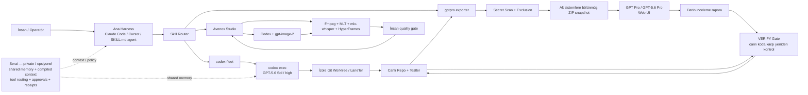
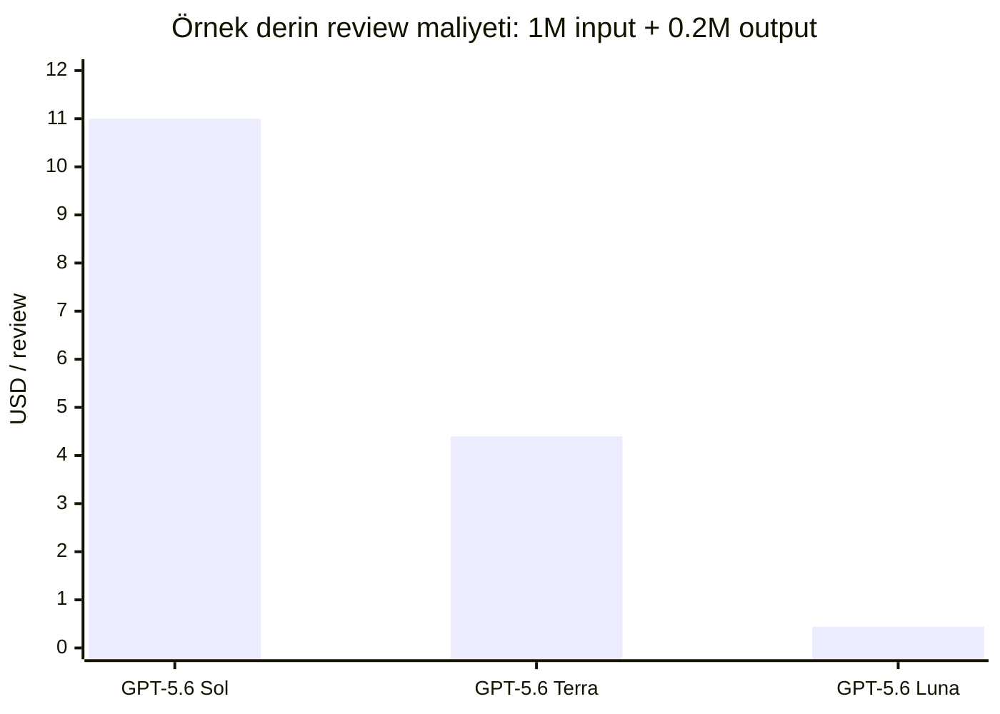
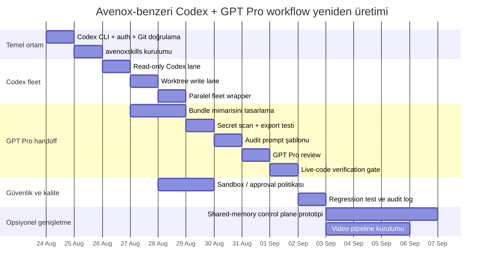

# AvenoxAI Codex + GPT Projesi: Teknik Tersine-Mühendislik ve Yeniden Üretim Raporu

> Durum notu (2026-09-27): Bu, araştırmanın ilk tarihsel sürümüdür. Kaynakça/uygulanabilirlik düzeltmeleri v2'de, ikinci review düzeltmeleri v3'te işlendi; en güncel tamamlanmış sürüm `deep-research-report-v3.md` dosyasıdır. Bu dosyanın ilk araştırma oturumuna ait dahili `turn...` atıfları bağımsız kaynak olarak kullanılmamalıdır.

## Yönetici özeti

AvenoxAI kanalında “Codex + GPT” diye tek bir monolitik uygulamadan ziyade, **aynı geliştirme felsefesinin birbirine bağlanan birkaç parçası** görülüyor. İncelediğim birincil kaynaklarda en net şekilde doğrulanabilen yapı şudur: bir ana ajan/harness, yerel **OpenAI Codex CLI** süreçlerini `codex exec` ile paralel “lane”ler halinde çalıştırıyor; çok derin mimari veya kod incelemeleri için kod tabanı `gptpro` aracıyla temizlenip mantıksal ZIP paketlerine ayrılıyor; bu statik snapshot **GPT Pro / GPT‑5.6 Pro** tarafına aktarılıyor; dönen rapor doğrudan uygulanmıyor, canlı kod ağacında tekrar doğrulanıyor; daha geniş çapta ise özel geliştirilmekte olan **Serai** katmanı Codex, Claude Code, Cursor, Hermes ve benzeri ajanlara ortak bellek, derlenmiş context, araç yönlendirme, onay ve işlem kaydı sağlamak üzere tasarlanıyor. citeturn36view0turn36view2turn36view5turn28view2

En önemli teknik bulgu, sistemin **LangChain tabanlı olmaması**. Avenox’un yayımladığı `avenoxskills` kodunda Codex entegrasyonu doğrudan yerel CLI üzerinden yapılıyor; `codex-fleet` kendisini açıkça “plain local `codex` install” üzerinde çalışan, haricî control-plane gerektirmeyen bir skill olarak tanımlıyor. `gptpro` da API tabanlı bir agent framework yerine dosya paketleme + web UI handoff modeli kullanıyor. İncelediğim Avenox birincil kaynaklarında LangChain, LangGraph, OpenAI Agents SDK veya benzeri bir framework çekirdek bağımlılık olarak belirtilmiyor. citeturn36view2turn36view4turn36view1

Avenox’un halka açık `codex-fleet` skill’i varsayılan olarak **`gpt-5.6-sol` + `high` reasoning** kullanıyor ve Codex CLI için **0.128+** gerektiriyor. OpenAI’nin güncel belgeleri de `gpt-5.6-sol` modelini GPT‑5.6 ailesinin frontier modeli olarak tanımlıyor; API yüzeyinde modelin 1.05 milyon token context window’u ve 128 bin maksimum output’u bulunuyor. Codex CLI yüzeyinin model metadata/context sınırının API yüzeyinden farklı olabileceğine özellikle dikkat edilmeli: OpenAI’nin CLI changelog’u 0.144.6 paketinde GPT‑5.6 Sol/Terra/Luna için CLI metadata context window’unun 272.000 token olarak düzeltildiğini bildiriyor. citeturn36view2turn32search1turn32search6turn29search2

“GPT‑5.6 Pro” konusunda önemli bir nüans var. Avenox’un videosu bu adı kullanırken `gptpro-handoff` dokümanı genel olarak “GPT Pro on the ChatGPT web UI” diyor. OpenAI’nin güncel API belgelerinde ise Pro, zorunlu olarak ayrı bir model slug’ı değil: seçilmiş GPT‑5.6 modelinde `reasoning.mode: "pro"` etkinleştirilebiliyor. Buna karşılık ChatGPT’nin kredi tablosunda kullanıcı arayüzü tarafında “GPT‑5.6 Sol Pro” etiketi de mevcut. Dolayısıyla videodaki web-UI çalışmasının **tam backend snapshot/model kimliği halka açık kaynaklarda belirtilmemiştir**; “GPT‑5.6 Pro” adından API’de ayrı `gpt-5.6-pro` modeli varmış sonucu çıkarılmamalıdır. citeturn31view6turn36view0turn32search7turn35search15

Avenox yaklaşımının asıl yeniliği model seçiminden çok **context engineering + verification loop** tarafında. `gptpro-handoff` sıkı audit görevlerinde `VERIFIED` / `HYPOTHESIS` ayrımı, sabit invariant’lar, açık scope/anti-scope, belirli çıktı formatı ve “DO-NOT” roadmap öneriyor; keşif/research görevlerinde ise aynı promptun aşırı kısıtlanmaması isteniyor. Rapor geldikten sonra canlı kod tabanında yeniden doğrulama zorunlu kapı olarak tanımlanıyor. Bu, videolardaki “prompt öldü/context kazandı” tezinin kod tarafındaki en somut karşılığıdır. citeturn36view0turn38view0

Tam Serai sistemini birebir yeniden üretmek bugün mümkün değil: Avenox’un GitHub profili Serai’yi **private, active development** olarak tanımlıyor; `serai.run` da private beta kapısı gösteriyor. Buna karşılık Codex fleet, GPT Pro handoff ve video pipeline’ın önemli bölümleri yayımlanmış durumda ve bunlar kullanılarak kamuya açık mimarinin büyük kısmı yeniden kurulabilir. citeturn36view5turn28view2turn36view4

## Video envanteri, zaman damgaları ve kanıt düzeyi

YouTube doğrudan video sayfalarının bir kısmını araştırma sırasında throttle ettiği için, aşağıdaki liste **YouTube arama indeksinden ve Avenox’un bağlı GitHub kaynaklarından doğrulayabildiğim tüm proje-odaklı videoları** kapsıyor. Yalnızca ekranda görünen fakat açıklama/index/repo tarafında bulunmayan kodu güvenilir biçimde okuyamadığım yerlerde bunu “belirtilmemiş” olarak işaretledim; herhangi bir timestamp veya kod satırı tahmin edilmedi. YouTube’un throttle davranışı özellikle bazı video sayfalarının doğrudan transcript/frame erişimini engelledi. citeturn31view0turn31view4turn31view5

| Video | Projedeki rolü | Doğrulanabilen önemli bölümler | Kod/bağlantı izi | Kanıt |
|---|---|---|---|---|
| **Context Kazandı Demiştim — İşte Context'i Üreten Model: GPT 5.6 Pro** — `xmMwgggOAmw`, 8 Ağustos 2026 | GPT Pro’nun büyük codebase snapshot’ından context/inceleme üretmesi; Codex↔GPT Pro handoff’ın en doğrudan videosu | `00:00` giriş; `00:22` hedef kullanıcı/bağlam; `07:54` **“Skill'ler ve codebase export”**; `08:48` **“Codebase'i …”** — indeks burada açıklamayı kesiyor | `gptpro`, `gptpro-handoff` repo uygulamasıyla doğrudan örtüşüyor | citeturn26search3turn6search1turn36view0turn36view1 |
| **Context'i Yanlış Kullanıyorsunuz — Ben Böyle Yapıyorum \| Claude Code - Codex** — `4vWlWHDol-g`, yaklaşık 15 Ağustos 2026 | Context engineering ve model-routing yaklaşımı | `0:00` context paniğine gerek olmadığı giriş; `0:28` model merdiveni/routing tartışması | Açıklama indeksinde `codex-fleet → github.com/avenoxai` bağlantısı görülüyor | citeturn28search8turn24search0 |
| **Videolarımı Yapan Yapay Zeka Sistemini Paylaşıyorum** — `6jRuCfCiOLA`, yaklaşık 19 Ağustos 2026 | Avenox Studio: Codex/agent skill’leriyle video üretim sistemi | YouTube indeksinde güvenilir chapter listesi çıkmadı: **timestamp belirtilmemiş** | Public `avenoxskills` içinde `avenox-video`, `roughcut`, `graphics`, `thumbnail`; thumbnail tarafında paralel `gpt-image-2` işleri | citeturn37search1turn36view3turn36view4 |
| **Fable 5 ile Kanalımın En Değerli Videosunu Çektim — Skill'imi Paylaşıyorum** — `2n84xa99FRY`, Temmuz 2026 | Skill paylaşımı, codebase/context paketleme yaklaşımının öncülü/uygulaması | `0:00` giriş; `0:51` Codex/Cloud skill paylaşımı; `1:04` kaynakların ücretsiz olduğu bölüm; `1:57` codebase mimarisi | Açıklama indeksinde `avenox.lol/codex.md` | citeturn26search2turn10search3turn14search1 |
| **Sıkıcı Kodlama Yayını: Codex + Claude Code ile Çalışıyorum** | Gerçek çalışma oturumu; Codex + Claude Code + Serai altyapısı | İndekslenen varyantta `0:00` açılış/radyo; `07:12` Herder repo incelemesi; `09:04` model değiştirme felsefesi; `11:34` Codex bölümü | Açıklama `avenox.lol/radio/`; başka YouTube indeks kaydı yayını “Serai altyapısında Codex ve Claude Code ile gerçek çalışma oturumu” olarak tanımlıyor | citeturn10search6turn26search1turn30search1 |
| **AI'a (Claude) Oyun Fabrikası Kurmak — Bölüm 2** — `TREm_35AtB4` | GPT Pro’dan gelen bulguları Codex’e doğrulatma örneği | İndeks açıklamasında açıkça **“Codex'e doğrulatmak”** ve **“GPT Pro / Codex”**; `29:23` kapanış ve worktree tavsiyesi. GPT Pro/Codex bölümünün başlangıç zamanı indeks kesintisi nedeniyle **belirtilmemiş** | Worktree + doğrulama yaklaşımı | citeturn28search1turn30search2 |
| **20 AI Agent'ı Tek Hafızada Çalıştırdım \| Hermes - Claude - Codex** | Serai/shared-memory katmanının en doğrudan video göstergelerinden biri | Arama sonuçlarında başlık doğrulanıyor; güvenilir chapter/timestamp ve doğrudan video ID indekslenemedi: **belirtilmemiş** | GitHub profilindeki Serai açıklaması aynı agent seti/shared-memory tasarımıyla örtüşüyor | citeturn37search3turn37search5turn36view5 |
| **Context Toplamaya Saatler Harcıyorum, İşte Nedeni (Claude - Codex)** | Context’in elle/ajanlarla derlenmesi ve iki coding-agent arasında taşınması | Başlık Avenox’un video önerilerinde doğrulanıyor; ID/chapter **belirtilmemiş** | Serai’nin “compiled context” amacıyla kavramsal olarak örtüşüyor; bunun aynı implementation olduğunu video kaynağı doğrulamıyor | citeturn37search1turn36view5 |
| **Seni Hatırlayan Yapay Zekâ: Tek Komutla Kendi İkinci Beynini Kur** — `a-vO-Re4UqY`, 30 Haziran 2026 | Paylaşımlı/persisted memory düşüncesinin erken halka açık örneği | Güvenilir chapter dökümü alınamadı: **belirtilmemiş** | Açıklama indeksinde `avenox.lol/beyin.md` | citeturn8search8 |
| **Prompt Öldü, Context Kazandı — Modelin Gözünden Kanıtı** | Projenin prompt/context felsefesini anlatan destekleyici içerik | Arama sonuçlarında yaklaşık 21 dakikalık Avenox videosu olarak görünmekle birlikte doğrudan ID/chapter güvenilir biçimde çıkmadı | Kod implementasyonu için `gptpro-handoff/prompt-style.md` daha güçlü birincil kanıt | citeturn37search4turn37search8turn38view0 |

Buradaki “Sıkıcı Kodlama Yayını” için YouTube indeksinde **iki farklı video kimliği** (`Bgvie9LtQdk` ve `3inA7z3uk2I`) aynı veya çok benzer başlıklarla yüzeye çıktı. Bir indeks kaydı Serai/Codex/Claude çalışma açıklamasını, diğeri chapter listesini taşıyor. Bunların yeniden yükleme, ikinci yayın veya indeks eşleştirme hatası olup olmadığı halka açık metinden kesinleştirilemedi; bu nedenle iki ID’yi tek kayıt gibi kesin biçimde birleştirmek doğru olmaz. citeturn26search1turn10search6

Ayrıca kanalın **“GPT‑5.6 SOL ULTRA: Saatlerce Sapmadan Çalışan Model”**, **“GPT‑5.6 Sol vs. Claude Fable 5”**, **“GPT‑5.6 SOL'un Bu Yaptığı…”** ve çoklu model benchmark videoları GPT‑5.6 Sol’un kapasitesini gösteriyor, fakat bunlar Codex→GPT Pro→verification mimarisini doğrudan anlatmadığından ana proje envanterinden ayrı tutulmalıdır. Avenox GitHub profili de model benchmark çıktılarını “model tests” kategorisinde, agent infrastructure’dan ayrı sınıflandırıyor. citeturn26search9turn6search2turn8search2turn36view5

**Video açıklamalarından / proje kaynaklarından doğrulanabilen bağlantılar:**

```text
https://avenox.lol/codex.md
https://avenox.lol/beyin.md
https://avenox.lol/radio/
https://github.com/avenoxai
https://github.com/avenoxai/avenoxskills
https://serai.run/
```

İlk üçü ilgili YouTube indeks açıklamalarında yüzeye çıktı; `avenoxskills` ve Serai adresleri Avenox’un resmî GitHub profil/repo kaynaklarıyla doğrulanıyor. citeturn14search1turn8search8turn10search6turn36view4turn36view5turn28view2

## Kod, CLI, konfigürasyon ve prompt dökümü

Önemli bir kaynak sınırlaması var: YouTube video dosyalarının karelerini güvenilir biçimde indiremediğim için **yalnızca videonun ekranında görünen ve başka hiçbir yerde yayımlanmamış kod parçalarını birebir transkribe etmek mümkün olmadı**. YouTube sayfaları araştırma sırasında fetch-throttling uyguladı. Bu yüzden aşağıdaki “birebir” bloklar videolarla bağlantılı **Avenox’un yayımladığı çalışan repo kodundan** alınmıştır; yalnız ekran görüntüsünde kalmış parçalar ise “belirtilmemiş” kabul edilmiştir. Avenox’un kendi GitHub profili YouTube’da cilalanmış açıklamaların, GitHub’da ise raw prompt’ların, model output’larının, failure’ların ve çalışan kodun tutulduğunu söylüyor. citeturn31view0turn31view5turn36view5

**Skill kurulumu — kaynakta birebir:**

```bash
git clone https://github.com/avenoxai/avenoxskills.git
cp -R avenoxskills/skills/codex-fleet ~/.claude/skills/
```

`avenoxskills` repo’su skill’lerin Claude Code, Cursor ve `SKILL.md` okuyabilen diğer harness’larla kullanılabileceğini belirtiyor. citeturn36view4

**Codex’in temel çağrısı — kaynakta birebir:**

```bash
codex exec --skip-git-repo-check \
  -m gpt-5.6-sol \
  -c model_reasoning_effort=high \
  --sandbox read-only \
  "<PROMPT>" 2>/dev/null
```

Avenox skill’i bunu `gpt-5.6-sol`, `high` reasoning ve varsayılan `read-only` sandbox ile kullanıyor. OpenAI’nin resmî CLI referansı `codex exec`, `--sandbox`, `-c/--config` ve `--skip-git-repo-check` seçeneklerini doğruluyor; OpenAI ayrıca Git deposu kontrolünü atlamanın yalnız ortamın güvenli olduğundan eminseniz yapılmasını öneriyor. citeturn36view2turn35search2turn35search6

Aynı konuşmaya devam etmek için Avenox’un yayımladığı örnek:

```bash
echo "follow-up prompt" | \
  codex exec --skip-git-repo-check resume --last 2>/dev/null
```

Bu yaklaşım tek seferlik “her prompt yeni ajan” yerine gerektiğinde mevcut Codex thread’inin sürdürülmesini mümkün kılıyor. citeturn22view3

Görsel input için repo özellikle önemli bir CLI gotcha belgeliyor: `-i` argümanı promptu istemeden tüketebildiği için prompttan önce `--` ayıracı kullanılıyor. citeturn22view3

```bash
# Hatalı desen
codex exec [opts] -i ref1.png -i ref2.png "prompt text"

# Avenox'un önerdiği desen
codex exec [opts] -i ref1.png -i ref2.png -- "prompt text"
```

Image-generation tarafında `codex-fleet`, Codex’in yerleşik **`gpt-image-2`** aracını kullanıyor; repo ayrıca `gpt-image-2-2026-04-21` snapshot adını kaydediyor. API fallback durumunda `OPENAI_API_KEY` gerekiyor. OpenAI’nin güncel model sayfası GPT Image 2’yi mevcut state-of-the-art image generation/editing modeli olarak belgeliyor. citeturn22view3turn32search2

**GPT Pro için codebase export — kaynakta birebir temel çağrı:**

```bash
PROJECT_ROOT=/path/to/repo ./scripts/export.sh
```

Konfigürasyonun temel biçimi:

```bash
cp bundles.example.conf bundles.conf

define_bundle core \
  "domain logic — the most important bundle for architecture review" \
  dir:packages/core

define_bundle db \
  "schema architecture only — no rows, no seed data" \
  dir:supabase/migrations \
  file:supabase/config.toml:supabase \
  file:docs/DB_PLAN.md

define_bundle docs \
  "architecture and convention context" \
  dir:docs dir:adrs file:README.md file:AGENTS.md
```

Bu exporter workspace paketlerini, servisleri ve dokümanları alt sistemlere göre ayırıyor; `node_modules`, build çıktıları, binary asset’ler ve secrets gibi GPT’ye taşınmaması gereken materyalleri dışarıda bırakıyor. Konfigürasyon yoksa workspace yapısını otomatik keşfedebiliyor. citeturn36view1

Çıktı klasörü ve prefix override örneği:

```bash
PROJECT_ROOT=/path/to/repo \
OUTPUT_DIR=~/Desktop/review-bundles \
BUNDLE_PREFIX=myproject \
./scripts/export.sh
```

Avenox repo’sunda export sırasında secret taraması bir “uyarı” değil **hard abort** olarak tasarlanmış; amaç API anahtarının veya benzeri credential’ın chat UI’a paketlenmesini engellemek. citeturn36view4turn22view0

**Video sistemi environment ayarları — kaynakta birebir:**

```bash
export STUDIO_JOBS="$HOME/video/projects"
export STUDIO_ROOT="/path/to/this/repo"
```

Avenox Studio yerel-first çalışıyor; macOS’ta `h264_videotoolbox`, Apple Silicon’da `mlx-whisper`, ayrıca `ffmpeg`, Python 3, MLT/`melt` ve HyperFrames için Node gerektiriyor. Linux için `libx264` ve CUDA tabanlı bir Whisper implementasyonu önerilen ikameler arasında. Kullanılan exact `ffmpeg`, Node, MLT ve Python sürümleri public belgede **belirtilmemiştir**. citeturn36view3

**Prompt engineering biçimi**, projenin en ayırt edici parçalarından biri. Kaynakta verilen İngilizce şablonu kelimesi kelimesine çoğaltmak yerine, aynı yapının teknik olarak eşdeğer Türkçe özeti şöyledir: citeturn38view0

```xml
<ROLE>
Bu kod tabanını generic tavsiyelerle değil, gerçek implementasyondan
hareketle değerlendirecek belirli bir kıdemli uzman rolü.
</ROLE>

<TASK>
Verilecek karar veya deliverable.
Birden fazla hedef varsa açıkça numaralanmış hedefler.
</TASK>

<CONTEXT>
Gerçek mimari.
Önce okunacak authoritative dosyalar.
İlgili file anchor'ları.
Ölçümler / empirical signals.
Doğrulanması veya çürütülmesi gereken hipotezler.
Değiştirilemez invariant'lar.
</CONTEXT>

<UNCERTAINTY>
Her bulguyu VERIFIED veya HYPOTHESIS olarak ayır.
Kaynakta olmayan line number/API/ölçüm üretme.
Varsayımları açıkça belirt.
</UNCERTAINTY>

<OUTPUT>
Kısa yönetici özeti.
Kanıta dayalı bulgular.
Önceliklendirilmiş roadmap.
Invariant'ı ihlal eden öneriler için DO-NOT kayıtları.
Sınırlı sayıda açık soru.
</OUTPUT>

<CONSTRAINTS>
Ekli kod ve dokümanlara dayan.
Docs/code drift'i ayrıca işaretle.
Gerekmedikçe sıfırdan rewrite önermeme.
Governance/consistency invariant'larını zayıflatmama.
</CONSTRAINTS>
```

Avenox’un “prompt house style”ı ayrıca **audit için tight leash, research için loose leash** öneriyor. Audit’te `VERIFIED/HYPOTHESIS`, sabit çıktı ve confirm/refute zorlanırken; araştırmada modelin verilen hipotezlerin ötesine geçmesine, framing’i sorgulamasına ve yeni teori üretmesine açık izin veriliyor. Her iki durumda da invariant’lar sert tutuluyor. citeturn36view0turn38view0

Bu yapı klasik anlamda bir **fine-tuning** değildir. Halka açık kaynaklarda model ağırlıklarının eğitildiğine, LoRA/adaptor kullanıldığına veya OpenAI fine-tuning endpoint’inin kullanıldığına dair kanıt yok. “Bir iyi promptu house reference olarak sakla ve yeni prompt yazmadan önce oku” tavsiyesi ise pratikte bir **in-context exemplar/few-shot-benzeri çalışma biçimi** oluşturuyor, ancak bunun API düzeyinde formal few-shot dataset mekanizması olduğu söylenmiyor. citeturn38view0

## Modeller, bağımlılıklar ve yeniden kurulan sistem mimarisi

Aşağıdaki tablo “videoda/repo’da gerçekten kullanılan”, “resmî olarak doğrulanabilen” ve “belirtilmemiş” alanlarını ayırıyor.

| Bileşen | Avenox’ta doğrulanan kullanım | Sürüm/model | Teknik durum |
|---|---|---|---|
| **OpenAI Codex CLI** | Ana coding-agent execution katmanı; `codex exec`, paralel lane, worktree | Avenox minimumu **0.128+**; public skill exact patch’e pinlemiyor | OpenAI CLI resmî olarak non-interactive `exec`, sandbox ve automation destekliyor. citeturn36view2turn29search0turn35search6 |
| **GPT‑5.6 Sol** | `codex-fleet` varsayılan coding modeli | `gpt-5.6-sol`, reasoning=`high` | API’de 1.05M context/128K output; Sol GPT‑5.6 ailesinin frontier modeli. citeturn36view2turn32search1turn32search5 |
| **GPT‑5.6 Pro / GPT Pro** | Slow/deep codebase review | Videoda “GPT 5.6 Pro”; skill’de “GPT Pro on ChatGPT web UI” | Exact backend snapshot **belirtilmemiş**. API’de Pro ayrı slug olmak zorunda değil; `reasoning.mode="pro"` olarak uygulanıyor. citeturn31view6turn36view0turn32search7 |
| **GPT Image 2** | Görsel/thumbnail üretimi | `gpt-image-2`; repo ayrıca `gpt-image-2-2026-04-21` snapshot’ını kaydediyor | OpenAI resmî modeli. citeturn22view3turn32search2 |
| **Claude Code / Cursor** | Ana harness veya Codex’i çağırabilecek parent agent seçenekleri | Exact Claude modeli akışa göre değişiyor; repo tek bir sürüme pinlemiyor | `codex-fleet` her `SKILL.md` harness’ıyla kullanılabiliyor. citeturn36view2turn36view4 |
| **Serai** | Shared context/control-plane | Private beta; implementation version **belirtilmemiş** | Scoped memory, compiled context, governed tool routing, approvals, receipts, workflows, version history amaçlanıyor. citeturn36view5turn28view2 |
| **LangChain / LangGraph** | Public Avenox implementationında bulunamadı | **Kullanım belirtilmemiş / kanıt yok** | Alternatif implementation olarak uygun olabilir; Avenox’un yayımlanmış çekirdeğinin bağımlılığı değildir. citeturn36view4turn36view2 |
| **zip / rsync** | GPT Pro bundle üretim araçları | Sürümler **belirtilmemiş** | `gptpro` requirements. citeturn19view0turn36view1 |
| **mlx-whisper** | Avenox Studio transkripsiyon | Model: `whisper-large-v3-turbo`; paket sürümü **belirtilmemiş** | Apple Silicon yerel transcription. citeturn22view2turn36view3 |
| **ffmpeg** | Video encoding/compositing | **Belirtilmemiş** | macOS `h264_videotoolbox`; Linux alternatifi `libx264`. citeturn36view3 |
| **MLT / melt** | Timeline/render pipeline | **Belirtilmemiş** | `.mlt` dosyaları Kdenlive/Shotcut’ta elle finish edilebiliyor. citeturn36view3 |
| **Node + HyperFrames** | Motion graphics | Sürümler **belirtilmemiş** | Video graphics branch. citeturn36view3 |
| **Docker/Kubernetes** | Public Avenox workflow’da kanıtlanmadı | **Belirtilmemiş** | Serai private olduğu için production container topology bilinmiyor. citeturn36view5turn28view2 |
| **CI/CD** | Avenox’un yayımlanmış Codex+GPT handoff’ında belirtilmemiş | **Belirtilmemiş** | Codex genel olarak CI’da çalıştırılabilir, fakat bu Avenox’un bunu kullandığını kanıtlamaz. citeturn35search2turn35search35 |

API ve Codex yüzeylerini karıştırmamak kritik. OpenAI’nin güncel API belgelerinde `gpt-5.6-sol` için 1.05M context verilirken, Codex CLI changelog’unda 0.144.6 için paketlenmiş model metadata context’i 272K olarak düzeltilmiş. Büyük repo bundle’ları tasarlarken **“API model 1M alıyor, dolayısıyla Codex CLI da aynı effective context’e sahiptir” varsayımı yapılmamalı**. citeturn32search6turn29search2

Yeniden kurulmuş veri akışı aşağıdaki gibi:



Bu diyagramdaki Serai bağlantısı **kavramsal rekonstrüksiyondur**, public backend code’u değildir. Avenox’un public tanımı Serai’nin modelin “dışında” durup memory/context/tool-routing/approval/receipts sağladığını söylüyor; buna karşılık `codex-fleet` Serai’ye ihtiyaç duymadan yerel Codex ile tek başına çalışabiliyor. citeturn36view5turn36view2

Mimarinin kritik veri akışı iki farklı “zeka modu” kullanıyor. **Agentic lane** olan Codex canlı dosya sistemini okuyup komut/test çalıştırabiliyor. **Deep static reviewer** olan GPT Pro ise Avenox’un workflow tanımına göre shell, live repo ve tool erişimine sahip değil; yalnız yüklenen snapshot’ı görüyor. Bu nedenle GPT Pro “propose/reason”, canlı Codex/harness ise “verify/implement” rolüne konmuş. citeturn36view0turn36view1

Güvenlik/guardrail katmanları da mimarinin içine yerleştirilmiş. Codex tarafında Avenox varsayılanı `read-only`; yazma gerektiğinde scope yükseltiliyor, `danger-full-access` gibi yüksek etkili modlar için açık onay bekleniyor. OpenAI resmî belgeleri de sandbox ve approval’ı iki ayrı kontrol sınırı olarak tanımlıyor ve mümkün olan en dar erişimin kullanılmasını öneriyor. GPT Pro tarafında secret scan exportu abort edebiliyor, dönen bulgular canlı kodda yeniden doğrulanıyor; video pipeline’da ise insan final kalite kapısı. citeturn22view3turn35search3turn35search7turn36view4turn36view3

Serai, bu prensibi bir üst katmana taşıyor: shared memory, context compilation, governed tool routing, human approvals ve action receipts. Ancak database türü, embedding modeli, vector store, API framework, authentication sistemi, queue altyapısı, Docker image’ları, Kubernetes kullanımı, CI/CD düzeni veya production hosting sağlayıcısı public kaynaklarda **belirtilmemiştir**. citeturn36view5turn28view2

## Adım adım yeniden üretim ve örnek kod

En yüksek doğrulukla yeniden üretilebilecek şey, **Serai’nin özel backend’i değil, Codex fleet + GPT Pro handoff** workflow’udur. Aşağıdaki kurulum public Avenox skill’lerinin davranışını mümkün olduğunca yakın takip eder. citeturn36view4turn36view2turn36view1

**Başlangıç ortamı.** Git, güncel Codex CLI, bir ChatGPT/Codex hesabı ve GPT Pro handoff için ZIP/`rsync` araçları gerekir. OpenAI’nin resmî kurulum komutu macOS/Linux için aşağıdaki standalone installer’dır; npm yolu da destekleniyor. Avenox’un skill’i Codex CLI `0.128+` bekliyor. citeturn29search0turn36view2

```bash
curl -fsSL https://chatgpt.com/codex/install.sh | sh

# Alternatif:
npm install -g @openai/codex

codex --version
codex
```

OpenAI Türkçe yardım merkezi Codex’in mevcut ChatGPT planlarının parçası olduğunu, Codex’in kod yazma, review ve shipping işlerini yapabilen autonomous coding agent olduğunu belirtiyor. citeturn35search1

Ardından Avenox skill’lerini yükleyin:

```bash
git clone https://github.com/avenoxai/avenoxskills.git

mkdir -p ~/.claude/skills
cp -R avenoxskills/skills/codex-fleet ~/.claude/skills/
cp -R avenoxskills/skills/gptpro ~/.claude/skills/
cp -R avenoxskills/skills/gptpro-handoff ~/.claude/skills/
```

Skill’ler Claude Code’a özel olmak zorunda değil; Avenox bunların Cursor veya `SKILL.md` okuyabilen başka bir harness’ta kullanılabildiğini belirtiyor. citeturn36view4

**İlk görevi read-only çalıştırın:**

```bash
cd /path/to/your/repo

codex exec --skip-git-repo-check \
  -m gpt-5.6-sol \
  -c model_reasoning_effort=high \
  --sandbox read-only \
  "Bu repoyu incele. Mimari riskleri bul.
   Henüz hiçbir dosyayı değiştirme.
   Her bulgu için ilgili dosyayı ve doğrulama yöntemini belirt."
```

`--skip-git-repo-check` Avenox varsayılanının bir parçası olsa da OpenAI bu seçeneğin Git deposu güvenlik kontrolünü bypass ettiğini açıkça söylüyor. Gerçek projede zaten Git repo içindeyseniz bu flag’i kaldırmak daha muhafazakâr bir uygulamadır; bu, Avenox’un exact default’undan bilinçli bir güvenlik sapması olur. citeturn36view2turn35search2

**Yazma lane’ini ayrı worktree’ye alın.** Aşağıdaki küçük script, Avenox’un worktree isolation prensibinin yeniden üretim örneğidir; Avenox reposundan birebir alınmış bir script değildir:

```bash
#!/usr/bin/env bash
set -euo pipefail

BRANCH="agent/refactor-auth"
WORKTREE="../worktrees/refactor-auth"

git worktree add -b "$BRANCH" "$WORKTREE" HEAD

(
  cd "$WORKTREE"

  codex exec \
    -m gpt-5.6-sol \
    -c model_reasoning_effort=high \
    --sandbox workspace-write \
    --full-auto \
    "Auth modülünü yalnız bu worktree içinde refactor et.
     Mevcut testleri koru.
     Yeni davranış için regression test ekle.
     Bitince test komutunu çalıştır ve sonucu raporla."
)
```

Avenox `codex-fleet`, bir veya yirmi lane’i paralel çalıştırabilecek şekilde tasarlandığını ve concurrent write lane’lerde worktree isolation kullandığını söylüyor. OpenAI’nin kendi ürün dokümanlarında da izolasyon ve çoklu agent/worktree çalışma biçimleri destekleniyor. citeturn36view2turn0search6

**Paralel investigation örneği.** Bu kod da yeniden üretim için tarafımdan yazılmıştır:

```bash
prompts=(
  "Auth akışındaki race condition risklerini araştır. Değişiklik yapma."
  "Database migration dosyalarını backward compatibility açısından incele. Değişiklik yapma."
  "API error handling ve retry davranışını incele. Değişiklik yapma."
)

for p in "${prompts[@]}"; do
  codex exec \
    -m gpt-5.6-sol \
    -c model_reasoning_effort=high \
    --sandbox read-only \
    "$p" >"/tmp/codex-$RANDOM.log" 2>&1 &
done

wait
```

Bu, Avenox’un “bağımsız işler varsa hepsini paralel fire et” yaklaşımını taklit eder; exact fleet scheduling algoritması bu kısa örnek değildir. citeturn36view2

**Derin GPT Pro review için snapshot oluşturun.**

```bash
cd /path/to/avenoxskills/skills/gptpro

PROJECT_ROOT=/path/to/your/repo \
OUTPUT_DIR="$HOME/Desktop/review-bundles" \
BUNDLE_PREFIX=myproject \
./scripts/export.sh
```

Büyük monorepo için örnek `bundles.conf`:

```bash
define_bundle core \
  "Ana domain ve business logic" \
  dir:packages/core

define_bundle api \
  "HTTP/API surface ve auth" \
  dir:apps/api \
  dir:packages/auth

define_bundle db \
  "Yalnız database schema ve migrations; production row yok" \
  dir:supabase/migrations \
  file:supabase/config.toml:supabase

define_bundle docs \
  "Architecture, ADR ve agent talimatları" \
  dir:docs \
  dir:adrs \
  file:README.md \
  file:AGENTS.md
```

Bölmeyi framework klasörlerine göre değil **modelin sorunu nasıl arayacağına göre** yapmak Avenox’un temel tavsiyelerinden biri: model “bu sorunun kodu hangi bundle’da olur?” sorusunu kolay cevaplamalı. citeturn36view1

**GPT Pro promptunu üretin.** Avenox’un house style’ını baz alan, fakat yeni yazılmış bir örnek:

```xml
<ROLE>
You are the principal engineer reviewing a production authentication system.
Answer from the attached code, not from generic best practices.
</ROLE>

<TASK>
Determine whether refresh-token rotation can create duplicate valid sessions.
Return a prioritized fix plan only for issues supported by evidence.
</TASK>

<CONTEXT>
READ docs/AUTH_ARCHITECTURE.md FIRST.

Hard invariants:
- Existing mobile clients must remain compatible.
- Database migration must be zero-downtime.
- Revocation semantics must not be weakened.

Seed hypothesis:
H1: Two concurrent refresh requests may both succeed.
This is only a hypothesis. Confirm, refute, or extend it against the code.
</CONTEXT>

<UNCERTAINTY>
Mark findings VERIFIED or HYPOTHESIS.
Never invent line numbers or APIs.
</UNCERTAINTY>

<OUTPUT_FORMAT>
1. Executive summary
2. Evidence-backed findings
3. Reproduction path for each verified bug
4. Prioritized roadmap
5. DO-NOT changes that violate invariants
</OUTPUT_FORMAT>
```

Bu promptun önemli özelliği “daha çok düşün” dememesi. Avenox özellikle reasoning tier’ının web UI’da operator tarafından seçildiğini, prompt içine `xhigh` veya benzeri reasoning talimatları koymanın gereksiz context tükettiğini söylüyor. OpenAI’nin GPT‑5.6 rehberi de aynı doğrultuda API’de reasoning effort/mode’un request parametresiyle yönetilmesini ve promptun goal/context/constraints/evidence/success criteria’ya odaklanmasını öneriyor. citeturn36view0turn38view0turn32search7

**Handoff döngüsü şu şekilde uygulanmalı:**

```text
SCOPE
  ↓
AUTHOR prompt
  ↓
FRESHEN code snapshot
  ↓
HAND OFF to GPT Pro
  ↓
RECEIVE report
  ↓
VERIFY every finding against LIVE repository
  ↓
IMPLEMENT only verified findings
  ↓
TEST / REVIEW
```

Bu sıra Avenox’un `gptpro-handoff` dokümanındaki temel workflow’dur. Özellikle `VERIFY` bir tavsiye değil “gate” olarak tanımlanıyor. citeturn36view0

GPT Pro raporunu alan coding harness için uygulanabilir verification promptu:

```text
Attached report GPT Pro tarafından statik snapshot üzerinde üretildi.

Görev:
1. Her VERIFIED iddiayı canlı repo üzerinde bağımsız olarak kontrol et.
2. Dosya değişmişse rapordaki bulguyu yeniden değerlendir.
3. Reproduction/test ile kanıtlanamayan iddiayı implement etme.
4. Sonucu:
   CONFIRMED
   REFUTED
   STALE
   NEEDS_MORE_EVIDENCE
   kategorilerinden biriyle etiketle.
5. Yalnız CONFIRMED bulgular için minimal patch öner.
```

Bu metin yeni bir yeniden üretim örneğidir; Avenox’un “proposes → verify → implement” prensibini operationalize eder. citeturn36view0

**Video-production dalını da kuracaksanız** `STUDIO_JOBS` ve `STUDIO_ROOT` ayarlanıp `ffmpeg`, `mlx-whisper`, MLT ve Node/HyperFrames kurulmalıdır. Pipeline’ın public tasarımı media’yı cloud-sync klasörlerine koymuyor; preview → human notes → final render döngüsü uyguluyor. Avenox “taste” aşamasını tamamen otomatikleştirmek yerine `.mlt` dosyasının Kdenlive/Shotcut’ta elle finish edilmesini de destekliyor. citeturn36view3

**Serai’nin public olmayan parçasını yaklaşık yeniden üretmek** gerekiyorsa bunu Avenox implementasyonu gibi değil bir alternatif olarak kurmak gerekir. Minimum karşılık şu servislerden oluşabilir: PostgreSQL/SQLite tabanlı scoped memory; prompt/context compiler; agent registry; tool-policy gateway; approval queue; append-only action receipt log; run/workflow tablosu; Codex/Claude/Cursor adapter’ları. Bu bileşen listesi Serai’nin ilan edilen davranışlarının mühendislik karşılığına dair bir çıkarımdır; Avenox’un private source code’una dair bilgi değildir. Serai’nin kamuya açık tanımı yalnızca memory, compiled context, governed tool routing, approvals, receipts, workflows ve version history davranışlarını doğrular. citeturn36view5turn28view2

LangChain kullanılmak istenirse en yakın alternatif **LangGraph** olur: güncel LangGraph dokümanları durable execution, persistence, human-in-the-loop interrupts ve long-/short-term memory sağlayabiliyor; dolayısıyla Serai’nin ilan edilen davranışlarının bir kısmı state graph + checkpointer + store ile yeniden oluşturulabilir. Bunun Avenox’un gerçek implementation’ı olmadığı tekrar vurgulanmalıdır. citeturn39search0turn39search4turn39search6

## Maliyet, model ve hosting karşılaştırmaları

OpenAI’nin 21 Ağustos 2026 itibarıyla güncel model karşılaştırma sayfasında API için GPT‑5.6 Sol fiyatı milyon token başına **$5 input / $0.50 cached input / $30 output**; Terra **$2 / $0.20 / $12**; Luna **$0.20 / $0.02 / $1.20** olarak listeleniyor. OpenAI 30 Temmuz 2026’da Terra ve Luna fiyatlarını düşürdüğünü ayrıca Türkçe duyurdu; bu yüzden daha eski belgelerde görülebilen Terra $2.50/$15 veya Luna $1/$6 rakamları güncel hesapta kullanılmamalıdır. citeturn32search6turn35search22

| Model / yol | Güçlü taraf | Güncel API input/output | Avenox benzeri kullanım |
|---|---|---:|---|
| **GPT‑5.6 Sol** | En yüksek genel reasoning/coding kalitesi | $5 / $30 per 1M token | Final architecture review, zor bug, Codex ana lane. Avenox default’u. citeturn32search6turn36view2 |
| **GPT‑5.6 Terra** | Kalite/maliyet dengesi | $2 / $12 | Recon, rutin refactor, çok sayıda parallel lane için iyi maliyet alternatifi; Avenox’un public skill default’u değildir. citeturn32search6turn33search5 |
| **GPT‑5.6 Luna** | Çok düşük maliyet/high-volume | $0.20 / $1.20 | Dosya sınıflama, basit extraction, mekanik görevler; kritik final review için kalite testi gerekir. citeturn32search6turn33search5 |
| **GPT‑5.6 Pro mode** | Quality-first, yüksek compute | Seçilen GPT‑5.6 modelinin standart token fiyatları; fakat daha fazla model work/token tüketebilir | GPT Pro benzeri derin review’ı API’ye taşımak için en yakın resmî mekanizma. citeturn32search7 |
| **ChatGPT Pro web UI** | Manual bundle upload + deep interactive/non-agentic review | Bireysel Pro katmanları şu anda $100 ve $200/ay kullanım seviyelerine sahip | Avenox `gptpro-handoff` modeline en yakın operasyon biçimi. citeturn35search26turn36view0 |

Örnek olarak bir derin codebase incelemesinin **1,0 milyon uncached input + 200 bin output token** kullandığını varsayarsak, standart API fiyatıyla teorik maliyet Sol’da yaklaşık **$11**, Terra’da **$4.40**, Luna’da **$0.44** olur. Bu yalnız aritmetik bir örnektir; gerçek repo büyüklüğü, caching, tool calls ve Pro mode’un ek model çalışması maliyeti ciddi biçimde değiştirebilir. Pro mode’da OpenAI ek model çalışmasının raporlanan token kullanımına toplandığını ve seçilen modelin normal token oranlarıyla faturalandırıldığını belirtiyor. citeturn32search6turn32search7



Aynı örnek ayda 50 kez çalıştırılırsa yaklaşık Sol **$550**, Terra **$220**, Luna **$22** eder; bunlar API-only örnekleridir ve Avenox’un gerçek faturası değildir. Codex subscription/credit kullanımı API faturalandırmasından farklıdır. OpenAI’nin Codex credit rate card’ında Sol için 1M input token 125 credit, cached input 12.5 credit ve 1M output 750 credit olarak listeleniyor. citeturn33search1

Avenox’un kullandığı subscription-first yaklaşım açısından güncel OpenAI yardım merkezinde **Pro $100** katmanı Plus’a göre 5×, **Pro $200** ise 20× kullanım sağlıyor; plan limitine gelen uygun Plus/Pro kullanıcıları ayrıca Codex kredisi satın alabiliyor. Dolayısıyla tek geliştirici için public workflow’un aylık AI sabit maliyeti, GPT Pro seviyesine ihtiyaç varsa kabaca **$100–$200 abonelik bandından** başlayabilir; yoğun usage/credits bunun üzerine çıkar. Bu tahmin yalnız resmî abonelik fiyatına dayanır, Avenox’un kişisel harcamasını temsil etmez. citeturn35search26turn35search19

Hosting tarafında asıl public Avenox video pipeline **yerel-first** çalışıyor ve render için buluta upload yapmıyor. Serai’nin gerçek hosting sağlayıcısı açıklanmadığından aşağıdaki cloud seçenekleri yalnız yeniden üretim alternatifleridir. citeturn36view3turn36view5

| Hosting biçimi | Yaklaşık taban maliyet | Artıları | Eksileri | Avenox kanıtı |
|---|---:|---|---|---|
| **Yerel Mac / workstation** | Ek cloud ücreti $0; donanım/elektrik hariç | Repo ve media yerelde; düşük veri sızıntısı yüzeyi; video için hardware encoding | 24/7 servis ve takım paylaşımı zor | Video pipeline’ın gerçek public yaklaşımı. citeturn36view3 |
| **DigitalOcean küçük Droplet** | **$4/ay’dan** | Basit daemon/API/control-plane | DB/backups/HA ayrı | Alternatif; Avenox kullandığına dair kanıt yok. citeturn34search4 |
| **Railway Hobby** | **$5 minimum/ay** | Kolay deploy/logging, side-project için hızlı | Uzun-running agent compute’da usage hızla artabilir | Alternatif. citeturn34search2turn34search9 |
| **Render Starter** | **$7/ay** web service başlangıcı | Basit web API/background worker modeli | Yoğun local-agent workload için workstation kadar doğal değil | Alternatif. citeturn34search3 |
| **Serai gerçek production altyapısı** | **Belirtilmemiş** | Shared agent control plane | Kod/hosting/topology private | Public kaynak bunu açıklamıyor. citeturn36view5turn28view2 |

Görsel üretim ayrı maliyet kalemidir. OpenAI güncel fiyat sayfası GPT Image 2 için token bazlı image/text ücretlerini yayımlıyor; fakat tek görselin USD maliyetini yalnız “bir thumbnail = X dolar” diye sabitlemek doğru değildir, çünkü image size, quality, input image ve token kullanımı değişir. Avenox’un `codex-fleet` skill’i built-in Codex image generation ile API-key fallback’ini ayrıca ayırıyor. citeturn29search1turn32search2turn22view3

## Boşluklar, varsayımlar, riskler ve alternatif tasarımlar

En büyük bilinmeyen **Serai implementation’ı**. Public kaynaklar ürünün ne yapacağını ayrıntılı biçimde söylüyor ama nasıl yaptığını söylemiyor: database, event bus, embedding/vector search, context ranking, MCP implementation, authorization schema, multi-tenant isolation, secret manager, observability stack, deployment cloud, Docker/Kubernetes veya CI/CD bilgileri yok. Bunların herhangi birini “Avenox şunu kullanıyor” diye atamak kaynak dışı spekülasyon olur. citeturn36view5turn28view2

İkinci boşluk YouTube’daki **screen-only code**. Açıklama indeksleri chapter ve bazı bağlantıları verdi fakat video sayfalarının bir bölümü doğrudan fetch sırasında throttle edildi. Bu nedenle repo’da bulunmayan bir terminal çıktısı, `.env`, `config.toml` veya ekranda birkaç saniye gösterilen script güvenilir biçimde birebir transkribe edilemedi. Rapor bu alanlarda repo metnini screen transcription gibi göstermemektedir. citeturn31view0turn31view4turn31view5

Üçüncü boşluk “GPT‑5.6 Pro” adının tam teknik kimliği. Avenox video başlığından bunun GPT‑5.6 ailesinin Pro deneyimi olduğu açık, fakat public workflow dosyası yalnız “GPT Pro on the ChatGPT web UI” diyor. Güncel OpenAI API’sinde Pro bir `reasoning.mode` olabilir; ChatGPT rate-card ise “GPT‑5.6 Sol Pro” etiketi kullanabiliyor. Dolayısıyla exact web-backend snapshot ve request parametreleri **belirtilmemiştir**. citeturn31view6turn36view0turn32search7turn35search15

Dördüncü boşluk model-routing’in tüm karar tablosu. Public `fable-orchestration` açıklaması görevlerin yalnız türe göre değil **zorluğa göre** daha ucuz sub-agent/Codex lane’lerine yönlendirildiğini söylüyor; videodaki context bölümünde de model ladder düşüncesi var. Fakat üretimdeki tüm threshold’lar, telemetry ve hangi durumda hangi modelin seçildiği tek bir açık config olarak yayımlanmış değil. citeturn36view4turn24search0

**Fine-tuning kanıtı yoktur.** Public sistem, model eğitiminden ziyade context compilation, skill talimatları, prompt templates, static code snapshot’ları, persistent/shared memory ve verification üzerine kuruludur. Benzer şekilde Avenox’un bu workflow’da vector RAG, LangChain veya LangGraph kullandığını gösteren public birincil kaynak bulamadım. Serai’nin “compiled context” yapması, otomatik olarak vector DB/RAG kullandığı anlamına gelmez. citeturn38view0turn36view2turn36view5

**Alternatif olarak doğrudan OpenAI Responses API** ile web-UI handoff kaldırılabilir. `gpt-5.6-sol` + `reasoning.mode:"pro"` + file/context ingestion kullanılarak GPT Pro review programatik hale getirilebilir. Avantajı otomasyon, observability ve tekrar üretilebilirlik; dezavantajı API token maliyeti ve Avenox’un manuel web-UI workflow’uyla birebir aynı davranışın garanti edilmemesidir. OpenAI Pro mode’un aynı model üzerinde daha fazla compute kullanıp zor görevlerde reliability artırmak için tasarlandığını belirtiyor. citeturn32search7

**Alternatif olarak LangGraph** ile Serai’ye benzeyen orchestration katmanı yapılabilir. LangGraph checkpointer’ları thread state’i saklıyor, store uzun dönem/cross-thread memory sağlıyor ve interrupts insan onayıyla durdurup daha sonra aynı state’ten devam etmeye izin veriyor. Bu, Serai’nin ilan edilen memory + approval + workflow özelliklerine kavramsal olarak yakın; ancak Serai’nin gerçek koduna dair çıkarım değildir. citeturn39search0turn39search6turn39search17

| Yaklaşım | State/memory | İnsan onayı | Parallel agent | Code erişimi | Karmaşıklık |
|---|---|---|---|---|---|
| **Avenox public skills** | Harness + dosya/context; Serai olmadan sınırlı | Sandbox/operatör gate | `codex exec` fleet + worktree | Çok güçlü, local repo | En basit ve Avenox’a en yakın. citeturn36view2 |
| **Avenox + Serai** | Scoped shared memory + compiled context | Native hedef özellik | Birden çok agent ailesi | Agent’a göre | En yakın tam vizyon fakat backend private. citeturn36view5 |
| **LangGraph replacement** | Checkpointer + long-term Store | Durable interrupts/HITL | Graph/subagent modeli | Tool adapter gerekir | Daha fazla framework kodu ama açık ve stateful. citeturn39search0turn39search6turn39search15 |
| **Saf Responses API** | Uygulamanın yönettiği conversation/context | Uygulamanın gate’i | GPT‑5.6 multi-agent beta veya application orchestration | Tool/function layer gerekir | API-native, web handoff yok. citeturn32search7 |
| **Yalnız Codex CLI** | Codex thread/session | Codex sandbox/approvals | Native/subagent + dışarıdan fleet | Local repo’ya en doğal erişim | GPT Pro static-review katmanı olmadan en az parça. citeturn29search0turn35search3 |

Bence kaynaklardan çıkan en önemli mimari ders, **“en büyük modeli her işe ver” değil, farklı epistemik rolleri ayırmak**: canlı kodu değiştirebilen ajan, statik ama çok derin düşünen reviewer ve insan approval gate aynı şey değil. Avenox workflow’u GPT Pro’nun tool eksikliğini “daha derin statik reasoning” ile; Codex’in agentic yeteneğini ise “live verification/test/implementation” ile kullanıyor. Bu yorum doğrudan Avenox’un “no shell/live repo” ile “verify against live code” karşıtlığına dayalı bir mimari çıkarımdır. citeturn36view0

## Yeniden üretim zaman çizelgesi

Aşağıdaki plan, tek bir deneyimli geliştiricinin **public Avenox workflow’unu** çalışır prototip olarak yeniden kurması için tarafımdan hazırlanmış yaklaşık bir takvimdir; Avenox’un kendi geliştirme süresi değildir. Tam Serai klonu kapsam dışıdır çünkü implementation private’dır. Public skill’lerin self-contained olması ve Serai gerektirmeden local Codex üzerinde çalışabilmesi ilk prototipi önemli ölçüde küçültür. citeturn36view2turn36view5



İlk **iki ila üç iş gününde** çalışan `codex exec` + worktree prototipi; yaklaşık **bir haftada** bundle/export → GPT Pro → verify loop’u; bundan sonra birkaç gün içinde basit shared-memory/control-plane prototipi makul bir mühendislik hedefidir. Bu süreler model çağrı gecikmesi ve mevcut repo karmaşıklığına bağlı tahminlerdir. Avenox’un `gptpro-handoff` dokümanında tek bir derin GPT Pro cevabının yaklaşık **50–60 dakika** sürebildiği belirtiliyor; dolayısıyla gerçek throughput değerlendirmesinde sadece token maliyeti değil wall-clock latency de ölçülmelidir. citeturn36view0

Sonuçta kamuya açık kaynaklarla en yüksek güvenle yeniden üretilebilen Avenox sistemi şu formülle özetlenebilir:

```text
iyi derlenmiş context
        +
yerel agentic Codex lane'leri
        +
izole worktree'ler
        +
secret-safe codebase snapshot
        +
slow/deep GPT Pro review
        +
canlı kodda zorunlu verification
        +
insan approval gate
        =
Avenox'un public Codex + GPT çalışma modelinin çekirdeği
```

Bu çekirdeğin üstündeki **Serai shared-memory/control-plane**, production deployment ayrıntıları, tam context-ranking algoritması, database/queue altyapısı, container/CI/CD yapısı ve yalnız videoda görünmüş fakat repoya aktarılmamış ekran kodları ise 21 Ağustos 2026 itibarıyla kamuya açık kaynaklarda **belirtilmemiştir**. citeturn36view2turn36view0turn36view5turn28view2
